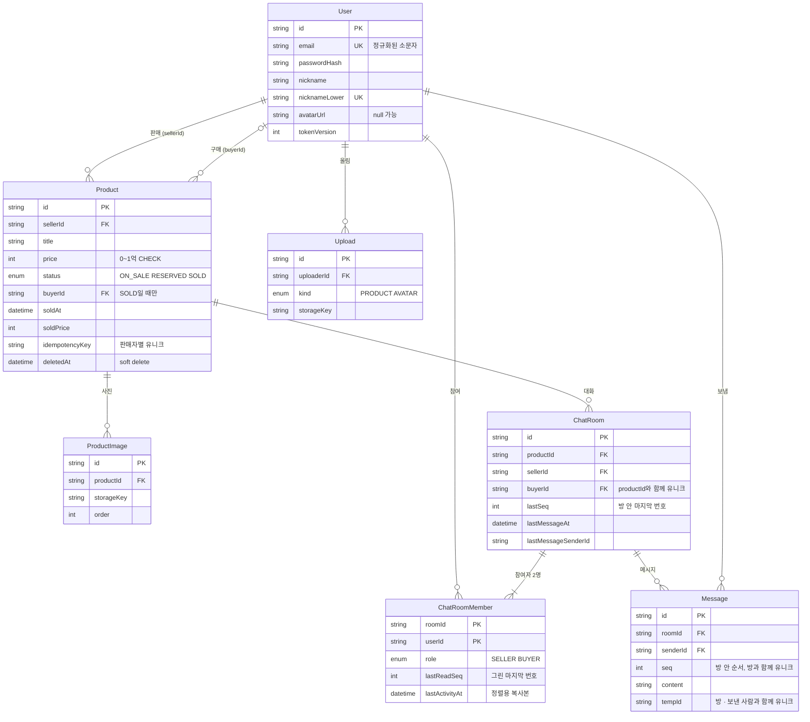

# 백엔드 설계

[문서 목차](../README.md) · [흐름 설계](flow.md) · [프론트엔드 설계](frontend.md) · [백엔드 설계](backend.md) · 기능별 요구사항: [features/](../features/00-common.md)

**백엔드 설계는 인증·권한, 거래 데이터의 정합성, 메시지 저장·전달을 다룹니다.** 요청 계층부터 데이터 모델, 트랜잭션, 오류 처리, 소켓, API 계약까지 열 개 문서로 구성했습니다. 현재는 설계 단계이며 서비스 코드는 구현 예정입니다.

## 이 문서의 구성

| 문서 | 핵심 결론 |
| --- | --- |
| [01 요청 계층](#01--요청-계층) | 진입 → 인증 → 검증 → 컨트롤러 → 서비스 → 저장소. 권한은 자원을 읽어야 알므로 서비스에서 |
| [02 데이터 모델](#02--데이터-모델) | 테이블 7개 · Prisma 7 스키마(검증 통과) · ERD · 쿼리별 인덱스 · 깨지면 안 되는 규칙은 CHECK 제약으로 |
| [03 트랜잭션 경계](#03--트랜잭션-경계) | 쓰기 11종의 경계 · 경합은 유니크 + 조건부 UPDATE로 · 파일 삭제와 emit은 커밋 후 |
| [04 권한 매트릭스](#04--권한-매트릭스) | 엔드포인트 × 요청자 × 상품 상태 전 조합 · 401/403/404 고르는 기준 · 정책 함수 |
| [05 멱등성](#05--멱등성) | 상품 등록 `idempotencyKey` · 채팅방 유니크 · 메시지 `tempId` · 읽음 `GREATEST` |
| [06 에러 코드](#06--에러-코드) | 코드 19 + 소켓 5 · 프론트가 다르게 반응해야 할 때만 코드를 나눈다 |
| [07 보호 장치와 배치](#07--보호-장치와-배치) | rate limit 6종(전송은 토큰 버킷) · 프록시 뒤 IP · 업로드 검증 8단계 · 배치 4종 |
| [08 관찰 가능성](#08--관찰-가능성) | 요청 ID로 프록시 ~ 백엔드 연결 · 구조화 로그 · 남기지 않는 것 |
| [09 소켓 서버](#09--소켓-서버) | 이벤트 공통 처리 6단계 · 이벤트별 처리 · 서비스는 `Realtime` 인터페이스로만 알림 |
| [10 API 명세](#10--api-명세) | HTTP 25개 · 소켓 9개의 요청 · 응답 모양, 화면 단위 공유 타입, 엔드포인트마다 권한 · 에러 · 트랜잭션 |
| [11 구성과 시드](#11--구성과-시드) | 환경 변수 목록과 부팅 검증 · 로컬 실행 · 마이그레이션 규칙 · 시드 네 묶음 · 데모 계정의 제한과 초기화 |

## 주요 설계 결정

| 상황 | 처리 방식 | 문서 |
| --- | --- | --- |
| 동시에 같은 요청이 오면? (채팅방 두 번, 등록 재시도, 메시지 재전송) | "있는지 확인 후 생성" 대신 **유니크 제약이 판단**하고, 위반을 잡아 기존 것을 돌려준다 | [03](#03--트랜잭션-경계) · [05](#05--멱등성) |
| 삭제 중에 메시지가 오면? | 상품 행을 `FOR SHARE`로 읽어 진행 중인 삭제가 끝난 뒤의 값을 본다 | [03](#03--트랜잭션-경계) |
| 채팅 목록 · 배지를 인덱스 하나로 처리하려면? | `ChatRoomMember`에 `lastActivityAt`을 복사해 두는 비정규화 — 쓰기 두 행을 더 내고 읽기를 단순하게 | [02](#02--데이터-모델) |
| 서버가 재시작되면 메시지는? | 소켓은 통로일 뿐, 출처는 DB. 커밋 후 emit, 놓친 건 `after` 커서로 | [09](#09--소켓-서버) · [WebSocket 기술 노트](../tech-notes.md#websocket과-socketio) |
| 남의 채팅방 ID로 요청하면 403인가 404인가? | 비공개 자원은 404 — 403은 존재를 알려 준다 | [04](#04--권한-매트릭스) |

## 01 · 요청 계층

**요청은 진입 → 인증 → 검증 → 컨트롤러 → 서비스 → 저장소 순서로 처리하도록 설계했습니다.** 인증 미들웨어는 토큰으로 요청자를 확인하고, 서비스는 자원을 조회해 소유권·권한·업무 규칙을 판단합니다. 각 계층의 책임과 오류 전달 경로는 아래와 같습니다.

### 계층과 각 계층의 질문

```
요청 ─▶ ① 진입 ─▶ ② 인증 ─▶ ③ 검증 ─▶ ④ 컨트롤러 ─▶ ⑤ 서비스(권한 · 규칙 · 트랜잭션) ─▶ ⑥ 저장소 ─▶ DB
                                                         │
          ◀──────────────── ⑦ 에러 처리 ◀──────────────── 어디서든 AppError
```

| 계층 | 답하는 질문 | 아는 것 | **모르는 것** | 실패 시 |
| --- | --- | --- | --- | --- |
| ① 진입 | 이 요청을 받아도 되나 | 헤더 · 본문 크기 · Origin | 사용자 | `413 PAYLOAD_TOO_LARGE` · `403 ORIGIN_MISMATCH` · `429 RATE_LIMITED` |
| ② 인증 | 누구인가 | 쿠키의 JWT, `User.tokenVersion` | 어떤 자원에 접근하려는지 | `requireAuth`: `401 UNAUTHORIZED` · `optionalAuth`: 비로그인으로 통과 |
| ③ 검증 | 요청 모양이 맞나 | Zod 스키마, 정규화 함수 | DB 상태 (중복 여부 등) | `400 VALIDATION_FAILED` + `fields` |
| ④ 컨트롤러 | 어느 서비스를 부를까 | `req` · `res` | 업무 규칙 | — (판단하지 않음) |
| ⑤ 서비스 | 이 사람이 이 자원에 이걸 해도 되나, 규칙상 가능한가 | 정책 함수 · 상태 전이 표 · 트랜잭션 | HTTP (`req` · `res` · 상태 코드) | `AppError(code)` 던짐 |
| ⑥ 저장소 | 어떻게 읽고 쓰나 | Prisma, `deletedAt` 자동 주입 | 업무 규칙 | DB 오류 → 서비스가 해석 (예: 유니크 위반 → `EMAIL_TAKEN`) |
| ⑦ 에러 처리 | 사용자에게 무엇을 돌려주나 | 에러 코드 카탈로그 | — | 알 수 없는 오류는 `500 INTERNAL` + 로그 |

### 계층별 책임과 선택 근거

#### ① 진입 — 싸고 빠른 거절을 먼저

| 순서 | 미들웨어 | 이유 |
| --- | --- | --- |
| 1 | `requestId` — 프록시가 보낸 `X-Request-Id`를 쓰고 없으면 생성, 응답 헤더에도 | 로그 한 줄과 사용자 문의를 잇는 열쇠 ([08 관찰 가능성](#08--관찰-가능성)) |
| 2 | 보안 헤더 (`X-Content-Type-Options` · `Referrer-Policy` 등) | 응답 전부에 동일하게 |
| 3 | 본문 크기 1MB (`/uploads`만 4MB) | 파싱 전에 자른다. 크게 파싱한 뒤 거절하면 이미 메모리를 썼다 [AC-CM-34] |
| 4 | 쓰기 요청의 `Origin` 검사 | 쿠키 인증이라 CSRF 대비. 프록시는 브라우저의 `Origin`을 **그대로 넘긴다**(서버 쪽 `fetch`는 `Origin`을 붙이지 않으므로 명시적으로 복사). 허용 목록은 운영이면 프론트 도메인 하나, staging이면 Vercel 미리보기 주소 패턴(`^https://neighbo-[a-z0-9-]+-<팀>\.vercel\.app$`)까지 — PR마다 주소가 바뀌어 목록으로는 못 적는다 [AC-CM-31] |
| 5 | IP 단위 rate limit (인증 경로) | 인증 전에 막아야 bcrypt 비용을 아낀다. IP는 프록시가 비밀 헤더와 함께 넘긴 값만 믿는다 ([07 보호 장치](#07--보호-장치와-배치)) |

#### ② 인증 — 두 모드, 토큰 검증 순서

`requireAuth`와 `optionalAuth` 두 가지만 둔다. 목록 · 상세는 `optionalAuth`라 비로그인도 통과하고, 로그인했으면 `viewer.isSeller` 같은 값을 계산할 수 있다 [결정 0011].

검증 순서: 쿠키 존재 → 서명(`HS256`만 허용) → 만료 → `purpose === 'session'` (60초 소켓 토큰은 같은 비밀로 서명되므로, 용도를 보지 않으면 세션 자리에서도 통과한다 — [인증 실험 01 ⑧](../tech-notes.md#jwt와-비밀번호-해시)) → `sub`로 사용자 조회 → `ver === user.tokenVersion` → `req.user` 주입 → 남은 기간이 절반 아래면 새 쿠키 [AC-CM-03, 04]. 새 쿠키는 브라우저가 프록시로 부른 요청에서만 실제로 저장된다 — 프론트 서버 렌더의 요청은 `Set-Cookie`를 버린다([프론트 01](frontend.md#01--렌더링-전략)). 사용자 조회를 생략하면 비밀번호 변경 후 옛 토큰을 막을 수 없어서(`tokenVersion`), 요청마다 기본키 조회 한 번을 감수한다.

`optionalAuth`에서 토큰이 만료 · 변조됐으면 **401을 내지 않고** 비로그인으로 처리하면서 쿠키 삭제 헤더를 보낸다. 상품을 보러 온 사람에게 "세션 만료"를 띄울 이유가 없다.

#### ③ 검증 — 정규화가 먼저, 스키마는 공유

1. `normalizeEmail` · `normalizePassword` · `normalizeText`로 값을 정리하고 [AC-CM-62, 63]
2. 공유 패키지의 Zod 스키마로 `params` · `query` · `body`를 각각 검증
3. 실패한 필드 **전부**를 `fields`에 담는다 [AC-CM-11]

검증은 "모양"만 본다. 이메일 중복처럼 DB를 봐야 아는 것은 서비스에서 한다 — 검증 계층이 DB를 부르기 시작하면 순수 함수로 테스트할 수 없다.

#### ④ 컨트롤러 — 얇게

`req`에서 값을 꺼내 서비스에 넘기고, 반환값을 상태 코드와 함께 응답한다. 분기 · 판단이 들어가면 서비스로 옮긴다. 상태 코드 선택(`200` vs `201`)도 서비스가 돌려준 `{ created: boolean }`을 보고 한다.

#### ⑤ 서비스 — 권한은 여기서

**권한을 미들웨어가 아니라 서비스에서 판단하는 이유**: "이 상품의 주인인가"는 상품을 읽어야 안다. 미들웨어에서 읽으면 서비스가 또 읽거나 `req`에 실어 넘겨야 하고, 그 사이 상태가 바뀔 수 있다. 서비스가 트랜잭션 안에서 한 번 읽고 그 값으로 권한과 규칙을 함께 판단한다. 권한 판단은 정책 함수로 모은다 ([04 권한 매트릭스](#04--권한-매트릭스)):

```ts
// 정책 함수는 순수 함수 — DB를 부르지 않고 읽어 온 값만 판단
export function canChangeStatus(user: AuthUser, product: Product): PolicyResult
```

서비스는 HTTP를 모른다. `AppError('INVALID_TRANSITION')`을 던지면 상태 코드는 ⑦이 카탈로그에서 찾는다. 그래서 같은 서비스를 소켓 핸들러가 그대로 부를 수 있다 ([09 소켓 서버](#09--소켓-서버)).

#### ⑥ 저장소 — 삭제된 것을 실수로 보지 않게

Prisma 클라이언트 확장으로 `Product` 조회에 `deletedAt IS NULL`을 자동으로 넣는다. 삭제된 것까지 봐야 하는 곳은 `withDeleted()`를 명시하고, 그 사용처는 두 곳뿐이다 — 채팅방 · 채팅 목록의 상품 요약, 구매 내역 [AC-PX-05, 결정 0006]. 이 규칙을 지키는지 테스트로 확인한다 [AC-PL-16].

**자동 주입이 닿지 않는 곳 두 군데**: 클라이언트 확장의 쿼리 훅은 최상위 모델 호출에만 걸린다. ① `$queryRaw` · `$executeRaw`(T6 · T7의 `FOR SHARE` 등)는 SQL을 그대로 보내므로 확장이 보지 못한다 ② 다른 모델에서 관계로 따라 들어가는 조회(`user.findUnique({ include: { products: true } })`, 관계 `_count`)도 `Product` 훅을 거치지 않는다. 그래서 원시 SQL은 저장소 함수 안에서만 쓰고 삭제 조건을 직접 적으며, `Product`로 가는 관계 조회는 `where: { deletedAt: null }`을 명시한다. 통합 테스트는 "삭제된 상품 하나를 만든 뒤 모든 목록 · 개수 API에서 그 상품이 새지 않는지"를 엔드포인트마다 확인한다 — 규칙이 아니라 결과를 검사한다. 확인 과정은 [기술 노트](../tech-notes.md) `prisma.md` ②.

저장소는 DB 오류를 그대로 올린다. 유니크 위반(`P2002`)을 `EMAIL_TAKEN`으로 바꾸는 것은 **어느 제약이 깨졌는지에 따라 의미가 다르므로** 서비스가 한다.

#### ⑦ 에러 처리 — 코드 하나, 문구는 카탈로그

`AppError(code, fields?)` → 카탈로그에서 HTTP 상태 · 한국어 메시지를 찾아 `{ error: { code, message, fields } }`로 응답 [AC-CM-10]. `AppError`가 아닌 예외는 `500 INTERNAL`, 스택은 로그에만 [AC-CM-13]. 카탈로그는 [06 에러 코드](#06--에러-코드).

### 폴더 구조 (예정)

```
backend-node/src/
├─ app.ts                 # 미들웨어 조립 순서가 이 파일 한 곳에 보이게
├─ middleware/            # requestId · origin · rateLimit · auth · validate · errorHandler
├─ modules/
│  ├─ auth/               # route · controller · service · schema
│  ├─ products/
│  ├─ uploads/
│  ├─ chat/
│  └─ me/
├─ policies/              # 순수 권한 함수 + 테스트
├─ db/                    # Prisma 클라이언트 · 확장(soft delete) · 트랜잭션 헬퍼
├─ socket/                # 연결 미들웨어 · 이벤트 핸들러 (서비스를 재사용)
├─ storage/               # ImageStorage 인터페이스 · local · s3 구현
├─ jobs/                  # 정리 배치
└─ errors/                # AppError · 카탈로그
```

기능별 모듈(`modules/products/`) 안에 계층을 두는 이유: 상품 규칙을 고칠 때 열어야 할 파일이 한 폴더에 모인다. 계층별 최상위 폴더(`controllers/` · `services/`)는 파일 수가 늘면 한 기능을 고치려고 다섯 폴더를 오가게 된다.

### 버린 대안

| 대안 | 버린 이유 |
| --- | --- |
| 권한을 라우트 미들웨어로 (`requireOwner('product')`) | 자원을 두 번 읽거나 `req`로 넘겨야 함. 트랜잭션 밖에서 읽은 값으로 판단하면 경합 시 틀림 |
| 서비스가 `req` · `res`를 받음 | 소켓에서 재사용 불가, 테스트에 가짜 HTTP 객체가 필요 |
| 검증 계층에서 중복 확인까지 | 검증이 DB에 의존하면 스키마를 프론트와 공유할 수 없음 |
| NestJS의 가드 · 파이프 · 인터셉터 | 같은 계층이지만 데코레이터 뒤에 순서가 숨음. 지금은 `app.ts`에서 순서가 보이는 쪽 [결정 0001] |

## 02 · 데이터 모델

**일곱 개 테이블로 거래·채팅·임시 업로드를 관리하고, 유일성과 데이터 범위는 DB 제약으로 보호하도록 설계했습니다.** 애플리케이션 검증은 필드별 오류 안내를 담당하고, 유니크 인덱스와 CHECK 제약은 동시 요청에서도 데이터 규칙을 유지합니다. [개요의 엔티티](../overview.md#22-핵심-엔티티와-핵심-필드)와 [요구사항 12절](../features/00-common.md#12-데이터-모델로-넘긴-것)을 스키마·제약·인덱스로 구체화했습니다.

### 1. 요구사항에서 넘긴 여섯 가지 결정

| # | 질문 | 결정 | 왜 |
| --- | --- | --- | --- |
| 1 | 읽음 위치를 `ChatRoomMember` 테이블에 둘까, `ChatRoom`의 두 컬럼(`sellerLastReadAt` · `buyerLastReadAt`)에 둘까 | **`ChatRoomMember` 테이블** + 정렬용 `lastActivityAt` 비정규화 | 채팅 목록은 "내가 참여한 방을 최근 활동순으로"인데, 두 컬럼 안은 `WHERE sellerId = me OR buyerId = me ORDER BY ...`가 되어 인덱스 하나로 정렬 · 커서를 처리할 수 없다(OR는 두 인덱스 결과를 합쳐야 함). 참여자 행에 `lastActivityAt`을 복사해 두면 `(userId, lastActivityAt DESC, roomId)` 인덱스 하나로 목록 · 커서 · 배지가 끝난다. 대가: 메시지마다 참여자 두 행을 갱신 |
| 2 | 임시 업로드를 `Upload` 테이블로 둘까, `ProductImage.productId`를 nullable로 둘까 | **별도 `Upload` 테이블**, 연결 시 `ProductImage`를 만들고 `Upload` 행은 같은 트랜잭션에서 삭제 | 아바타도 같은 업로드 경로를 쓰므로 `ProductImage`에 섞으면 상품 아닌 행이 생긴다. 정리 배치는 `Upload`만 보면 되고, `ProductImage`는 "상품에 붙은 사진"이라는 뜻을 잃지 않는다 |
| 3 | 거래완료 후 판매자가 가격을 고치면 구매 내역 가격도 바뀌어야 하나 | **`soldPrice` 스냅샷** — 거래완료 전이 때 저장, 판매중 복귀 시 `null` | 구매 기록은 거래 시점의 사실. 판매자 수정이 구매자 화면을 바꾸면 안 된다 [결정 0013] |
| 4 | ID 형식 | **전 테이블 `cuid()`** (Prisma 기본 생성) | 상품 · 방 목록 정렬은 `(정렬 시각, id)` 복합 커서, 메시지는 방별 번호 `seq`([결정 0016](../decisions.md#0016--방-안-순서와-읽음-위치는-시각이-아니라-방별-번호seq로-센다))로 하므로 ID 자체가 시간순일 필요가 없다. 형식이 하나면 검증 · 로그가 단순. 추측 불가 조건은 만족 [AC-CM-35] |
| 5 | 이메일 · 닉네임 유니크를 부분 인덱스(`WHERE deletedAt IS NULL`)로 둘까 | **1차는 일반 유니크.** 탈퇴(2차)가 생길 때 부분 인덱스로 바꾸는 마이그레이션 | 탈퇴가 없으니 `deletedAt`은 항상 `null` — 두 인덱스는 지금 같은 동작. Prisma 스키마가 부분 인덱스를 표현하지 못해 원시 SQL이 필요한데, 쓰지 않는 기능을 위해 미리 넣지 않는다 |
| 6 | 인덱스 | 아래 4절 — 쿼리마다 어떤 인덱스를 타는지 표로 | — |

### 2. ERD



`Notification` · `Category` · `Favorite` · `Trade` 테이블은 없다. 각각 없는 이유는 [개요 2.2](../overview.md#22-핵심-엔티티와-핵심-필드)와 결정 [0008](../decisions.md#0008--배지-숫자는-읽지-않은-방의-수다) · [0012](../decisions.md#0012--거래완료-시-구매자를-지정하고-구매-내역을-둔다).

### 3. Prisma 스키마

**Prisma 7.x 정식판 기준**(2026-11 확인 7.10.1). 7부터 연결 주소는 스키마가 아니라 `prisma.config.ts`에 두고, 클라이언트는 드라이버 어댑터(`@prisma/adapter-pg`)로 연결한다. 아래 스키마는 Prisma 스키마 검증기(`@prisma/prisma-schema-wasm`)로 **검증 통과**를 확인했다. npm `latest` 태그는 8.0 RC이므로 정식판이 나오기 전엔 7.x로 고정한다.

```prisma
generator client {
  provider = "prisma-client"
  output   = "../src/generated/prisma"
}

datasource db {
  provider = "postgresql" // 연결 주소는 prisma.config.ts
}

enum ProductStatus {
  ON_SALE
  RESERVED
  SOLD
}

enum UploadKind {
  PRODUCT
  AVATAR
}

enum MemberRole {
  SELLER
  BUYER
}

model User {
  id            String    @id @default(cuid())
  email         String    @unique // normalizeEmail() 결과만 저장
  passwordHash  String
  nickname      String // 표시용 — 입력한 대소문자 그대로
  nicknameLower String    @unique // 중복 판단용
  avatarUrl     String?
  tokenVersion  Int       @default(0) // 비밀번호 변경 시 +1 → 기존 토큰 무효
  isDemo        Boolean   @default(false) // 공용 데모 계정 — 비밀번호 · 프로필 변경 불가, 매일 초기화
  lastLoginAt   DateTime?
  createdAt     DateTime  @default(now())
  updatedAt     DateTime  @updatedAt
  deletedAt     DateTime? // 탈퇴(2차) 대비. 1차에는 항상 null

  products    Product[]        @relation("ProductSeller")
  purchases   Product[]        @relation("ProductBuyer")
  uploads     Upload[]
  roomsSold   ChatRoom[]       @relation("RoomSeller")
  roomsBought ChatRoom[]       @relation("RoomBuyer")
  memberships ChatRoomMember[]
  messages    Message[]
}

model Product {
  id             String        @id @default(cuid())
  sellerId       String
  title          String
  price          Int // 원 단위 정수. 0 = 나눔
  description    String        @default("")
  status         ProductStatus @default(ON_SALE)
  buyerId        String? // SOLD일 때만 값 (CHECK)
  soldAt         DateTime? // SOLD일 때만 값 (CHECK)
  soldPrice      Int? // 거래완료 시점 가격 스냅샷
  idempotencyKey String // 클라이언트가 폼을 열 때 만든 uuid
  createdAt      DateTime      @default(now())
  updatedAt      DateTime      @updatedAt
  deletedAt      DateTime?
  imagesPurgedAt DateTime? // 삭제 30일 후 파일 정리 완료 시각

  seller    User           @relation("ProductSeller", fields: [sellerId], references: [id])
  buyer     User?          @relation("ProductBuyer", fields: [buyerId], references: [id])
  images    ProductImage[]
  chatRooms ChatRoom[]

  @@unique([sellerId, idempotencyKey])
  @@index([deletedAt, createdAt(sort: Desc), id(sort: Desc)]) // 홈 목록 · 커서
  @@index([sellerId, status, createdAt(sort: Desc)]) // 마이페이지 판매 탭
  @@index([buyerId, soldAt(sort: Desc)]) // 구매 내역
}

model ProductImage {
  id           String   @id @default(cuid())
  productId    String
  storageKey   String // ImageStorage가 쓰는 키 — URL은 키에서 만든다
  url          String
  thumbnailUrl String
  width        Int
  height       Int
  order        Int // 0 = 대표
  createdAt    DateTime @default(now())

  product Product @relation(fields: [productId], references: [id], onDelete: Cascade)

  @@index([productId, order])
}

model Upload {
  id           String     @id @default(cuid())
  uploaderId   String
  kind         UploadKind
  storageKey   String
  url          String
  thumbnailUrl String?
  width        Int
  height       Int
  createdAt    DateTime   @default(now())

  uploader User @relation(fields: [uploaderId], references: [id])

  @@index([createdAt]) // 24시간 지난 고아 정리 배치
}

model ChatRoom {
  id                  String    @id @default(cuid())
  productId           String
  sellerId            String
  buyerId             String
  lastSeq             Int       @default(0) // 방 안 마지막 메시지 번호 — 저장 시 +1 하며 방 행을 잠근다 (결정 0016)
  lastMessageAt       DateTime? // 메시지가 없으면 null
  lastMessagePreview  String?
  lastMessageSenderId String?
  createdAt           DateTime  @default(now())

  product  Product          @relation(fields: [productId], references: [id])
  seller   User             @relation("RoomSeller", fields: [sellerId], references: [id])
  buyer    User             @relation("RoomBuyer", fields: [buyerId], references: [id])
  members  ChatRoomMember[]
  messages Message[]

  @@unique([productId, buyerId]) // 상품 × 구매자당 방 하나
  @@index([productId]) // 거래완료 바텀시트의 채팅 상대 목록 · 상품 변경 브로드캐스트
}

model ChatRoomMember {
  roomId         String
  userId         String
  role           MemberRole
  lastReadSeq    Int        @default(0) // 화면에 그린 마지막 메시지 번호 (결정 0016)
  lastActivityAt DateTime   @default(now()) // ChatRoom 활동 시각의 복사본 — 목록 정렬을 이 테이블 인덱스 하나로
  joinedAt       DateTime   @default(now())

  room ChatRoom @relation(fields: [roomId], references: [id])
  user User     @relation(fields: [userId], references: [id])

  @@id([roomId, userId])
  @@index([userId, lastActivityAt(sort: Desc), roomId(sort: Desc)]) // 채팅 목록 · 커서 · 배지
}

model Message {
  id        String   @id @default(cuid())
  roomId    String
  senderId  String
  seq       Int // 방 안 순서 — 커서 · 복구 · 읽음의 기준 (결정 0016)
  content   String
  tempId    String // 클라이언트가 만든 전송 식별자 — 재시도 중복 방지
  createdAt DateTime @default(now()) // 표시 전용. 트랜잭션 시작 시각이라 순서에 쓰지 않는다

  room   ChatRoom @relation(fields: [roomId], references: [id])
  sender User     @relation(fields: [senderId], references: [id])

  @@unique([roomId, seq]) // 과거 방향(before) · 이후 방향(after) 둘 다 이 인덱스로
  @@unique([roomId, senderId, tempId])
}
```

#### DB가 마지막으로 지키는 것 — CHECK 제약

Prisma 스키마로 표현할 수 없어 첫 마이그레이션 SQL에 직접 추가한다. 애플리케이션 검증을 통과한 버그 · 수동 수정 · 경합에도 깨지면 안 되는 것만 고른다.

```sql
-- 가격은 0 이상 1억 이하
ALTER TABLE "Product" ADD CONSTRAINT product_price_range CHECK (price BETWEEN 0 AND 100000000);
-- 거래완료일 때만 soldAt이 있다 (둘은 함께 움직인다)
ALTER TABLE "Product" ADD CONSTRAINT product_sold_at CHECK ((status = 'SOLD') = ("soldAt" IS NOT NULL));
-- 구매자 · 거래 가격은 거래완료일 때만
ALTER TABLE "Product" ADD CONSTRAINT product_buyer_only_sold CHECK (status = 'SOLD' OR ("buyerId" IS NULL AND "soldPrice" IS NULL));
-- 자기 물건의 구매자가 될 수 없다
ALTER TABLE "Product" ADD CONSTRAINT product_buyer_not_seller CHECK ("buyerId" IS NULL OR "buyerId" <> "sellerId");
-- 자기 물건에 채팅방을 만들 수 없다
ALTER TABLE "ChatRoom" ADD CONSTRAINT room_buyer_not_seller CHECK ("buyerId" <> "sellerId");
-- 빈 메시지 · 비정상적으로 긴 메시지. 정확한 1,000자(grapheme) 제한은 공유 스키마가 하고,
-- DB는 "어떤 1,000자도 통과하는" 상한만 둔다 — 가족 이모지 하나가 코드포인트 7~11개라 4,000은 정상 메시지를 막는다
ALTER TABLE "Message" ADD CONSTRAINT message_length CHECK (char_length(content) BETWEEN 1 AND 16000);
```

**왜 상태 전이(판매중 → 예약중 …)는 CHECK로 두지 않나**: CHECK는 한 행의 "현재 값"만 볼 수 있고 "이전 값"을 모른다. 전이 규칙은 트리거로만 강제할 수 있는데, 트리거는 규칙을 코드 밖으로 숨긴다 [결정 0001]. 대신 조건부 UPDATE(`WHERE status IN (허용된 이전 상태)`)로 서비스가 강제한다 ([03 트랜잭션](#03--트랜잭션-경계)).

### 4. 인덱스 — 쿼리마다 무엇을 타는가

| 쿼리 | 조건 · 정렬 | 인덱스 | 근거 AC |
| --- | --- | --- | --- |
| 홈 목록 | `deletedAt IS NULL ORDER BY createdAt DESC, id DESC` + 커서 | `Product(deletedAt, createdAt DESC, id DESC)` | AC-PL-01, 03 |
| 홈 목록 + 거래완료 숨김 | 위 + `status <> 'SOLD'` | 같은 인덱스 + 필터 (거래완료 비율이 낮아 충분) | AC-PL-13 |
| 제목 검색 | `title ILIKE '%q%'` | **1차는 순차 스캔 허용.** 상품 수만 건 이상이면 `pg_trgm` GIN 인덱스 | AC-PL-12 |
| 마이페이지 판매 탭 | `sellerId = me AND status = ? AND deletedAt IS NULL` | `Product(sellerId, status, createdAt DESC)` | AC-MP-02 |
| 구매 내역 | `buyerId = me AND status = 'SOLD'` (삭제 포함) | `Product(buyerId, soldAt DESC)` | AC-MP-04 |
| 판매자별 멱등키 확인 | `sellerId = ? AND idempotencyKey = ?` | 유니크 `Product(sellerId, idempotencyKey)` | AC-PC-08 |
| 채팅방 찾기 · 만들기 | `productId = ? AND buyerId = ?` | 유니크 `ChatRoom(productId, buyerId)` | AC-PD-13, 15 |
| 상품의 채팅 상대 · 채팅 수 | `productId = ?` | `ChatRoom(productId)` | AC-PD-04, AC-PL-01 |
| 채팅 목록 | `userId = me ORDER BY lastActivityAt DESC, roomId DESC` + 커서 | `ChatRoomMember(userId, lastActivityAt DESC, roomId DESC)` | AC-CL-01 |
| 배지 (읽지 않은 방 수) | 내 참여자 행 ⨝ 방, `r.lastSeq > m.lastReadSeq` | `ChatRoomMember(userId, ...)` 앞부분 + 방 기본키 | AC-NT-02 |
| 메시지 최신 50 · 과거 | `roomId = ? AND seq < 커서 ORDER BY seq DESC` | 유니크 `Message(roomId, seq)` 역방향 스캔 | AC-CH-10, 11 |
| 재연결 누락분 · 틈 채우기 | `roomId = ? AND seq > after ORDER BY seq LIMIT 101` | 같은 인덱스 정방향 | AC-CH-05 |
| 전송 재시도 중복 | `roomId · senderId · tempId` | 유니크 `Message(roomId, senderId, tempId)` | AC-CH-04 |
| 방별 읽지 않은 수 | `roomId = ? AND seq > lastReadSeq AND senderId <> me` | `Message(roomId, seq)` 범위 | AC-CL-04 |
| 고아 업로드 정리 | `createdAt < now() - 24h` | `Upload(createdAt)` | AC-PC-19 |

**확인 방법**: 구현 단계에서 각 쿼리를 시드 데이터(상품 1만 · 방 1천 · 메시지 10만)에 대해 `EXPLAIN ANALYZE`로 돌리고 결과를 [기술 노트 `postgres-constraints.md`](../tech-notes.md)에 남긴다.

### 5. 필드 규칙 요약

| 필드 | 저장 형태 | 검증 위치 | 근거 |
| --- | --- | --- | --- |
| `User.email` | `normalizeEmail()` 결과 (소문자 · NFKC · 공백 · 제로폭 제거) | 공유 스키마 + 유니크 | AC-SU-06 |
| `User.passwordHash` | `normalizePassword()` 후 bcrypt cost 12 | 공유 스키마 | AC-SU-09b, 23 |
| `User.nickname` / `nicknameLower` | 입력 그대로 / 소문자 | 공유 스키마 + 유니크(`nicknameLower`) | AC-SU-14 |
| `Product.price` | 정수 원 | 공유 스키마 + CHECK | AC-PC-06 |
| `Product.title` · `description` | `normalizeText()` 결과 | 공유 스키마 (grapheme 길이) | AC-PC-05, 07 |
| `Message.content` | `normalizeText()` 결과, 연속 줄바꿈 축소 | 공유 스키마 + CHECK(코드포인트 상한) | AC-CH-13, AC-CM-54 |
| 모든 시각 | `timestamptz` (UTC) | — | AC-CM-50 |

grapheme 길이는 DB가 셀 수 없으므로(Postgres `char_length`는 코드포인트) DB CHECK는 넉넉한 상한만 두고, 정확한 제한은 공유 스키마가 한다.

### 6. 바뀔 가능성

| 바뀌면 | 영향 |
| --- | --- |
| 그룹 채팅 | `ChatRoomMember`가 이미 있어 참여자 수만 늘리면 됨. 단 `ChatRoom(productId, buyerId)` 유니크와 `MemberRole`은 다시 설계 |
| 탈퇴 | 이메일 · 닉네임 유니크를 부분 인덱스로 (결정 5), 탈퇴 사용자 표시 규칙 |
| 후기 · 매너온도 | `Trade` 테이블로 `buyerId · soldAt · soldPrice` 승격 [결정 0012] |
| 상품 10만 건 이상 | 검색에 `pg_trgm`, 목록 인덱스를 `WHERE deletedAt IS NULL` 부분 인덱스로 |

## 03 · 트랜잭션 경계

**함께 성공하거나 실패해야 하는 DB 쓰기를 트랜잭션으로 묶고, 파일 삭제와 소켓 발행은 커밋 후 처리하도록 설계했습니다.** 중복 생성은 유니크 제약으로, 상태 변경은 조건부 UPDATE로, 메시지 순서는 방별 행 잠금으로 관리합니다. 아래 표는 작업별 경계와 실패 시 남는 상태를 정리한 것입니다.

### 원칙

| 원칙 | 이유 |
| --- | --- |
| 격리 수준은 Postgres 기본 `READ COMMITTED` | `SERIALIZABLE`은 충돌 시 재시도 루프가 필요하고, 이 서비스의 경합은 전부 "같은 행 · 같은 키"라 제약과 조건부 갱신으로 충분히 막힌다 |
| 검사 후 갱신(check-then-act) 대신 **조건부 갱신** | `SELECT status` → 판단 → `UPDATE`는 그 사이에 다른 요청이 끼어들 수 있다. `UPDATE ... WHERE status IN (...)` 한 문장이면 DB가 원자적으로 판단하고, 갱신된 행 수로 성공 여부를 안다 |
| 중복은 **유니크 제약**이 최종 판단 | "있는지 먼저 확인"은 동시 요청 둘이 모두 "없음"을 볼 수 있다 ([PostgreSQL 실험 01](../tech-notes.md#postgresql-제약과-트랜잭션)에서 재현) |
| 파일은 DB **커밋 후** 삭제 | 트랜잭션이 롤백되면 DB는 되돌아가지만 지운 파일은 안 돌아온다. 커밋 후 삭제가 실패하면 파일만 고아로 남고 배치가 치운다 — 반대(파일 없는 DB 행)보다 안전 |
| 소켓 emit은 **커밋 후** | 커밋 전에 보내면 롤백된 메시지를 상대가 본다. 커밋 후 emit이 실패해도 메시지는 DB에 있어 재연결 복구로 전달된다 ([WebSocket 기술 노트 ③](../tech-notes.md#websocket과-socketio)) |
| 트랜잭션 안에서 외부 호출 금지 | 이미지 처리 · 해시 · 네트워크 호출은 트랜잭션 밖에서 미리. 트랜잭션은 짧게 |
| 유니크 위반을 잡으면 **트랜잭션을 끝내고 새 쿼리로** 기존 행을 읽는다 | 오류가 난 트랜잭션은 롤백 전까지 모든 문장을 거부한다(`25P02`). 같은 트랜잭션에서 재조회하면 중복 요청이 `500`이 된다 ([PostgreSQL 실험 01 ⑦](../tech-notes.md#postgresql-제약과-트랜잭션)) |

### 쓰기 작업별 경계

| # | 작업 | 트랜잭션 안에서 (순서대로) | 커밋 후 | 경합 처리 | 중간 실패 시 남는 것 |
| --- | --- | --- | --- | --- | --- |
| T1 | 회원가입 | (단일 INSERT) | 쿠키 발급 | 이메일 · 닉네임 유니크 → `409` | 없음 |
| T2 | 상품 등록 | ① 멱등키로 기존 상품 조회 → 있으면 반환 ② `Upload` 행들이 본인 것 · 존재하는지 `FOR UPDATE`로 잠금 확인 ③ `Product` INSERT ④ `ProductImage` INSERT (업로드의 `storageKey` 재사용) ⑤ `Upload` DELETE | — | `(sellerId, idempotencyKey)` 유니크 위반 → 기존 상품 조회해 `200` | 없음. 파일은 업로드 때 이미 저장돼 있고 키만 옮김 |
| T3 | 상품 수정 | ① `UPDATE Product ... WHERE id AND sellerId AND deletedAt IS NULL` → 0행이면 `404` ② 빠진 사진의 `ProductImage` DELETE (키 목록 기억) ③ 새 업로드 → `ProductImage` INSERT, `Upload` DELETE ④ 남은 사진 `order` 재부여 | 빠진 사진 파일 삭제 | 마지막 저장이 이김 (낙관적 잠금 없음, 결정 0013) | 커밋 후 파일 삭제 실패 → 고아 파일. 30일 배치가 `ProductImage`에 없는 키를 정리 |
| T4 | 상태 변경 | ① 거래완료면 `buyerId`가 이 상품 방의 구매자인지 확인 ② `UPDATE Product SET status, buyerId, soldAt, soldPrice=price WHERE id AND sellerId AND deletedAt IS NULL AND status IN (허용된 이전 상태)` | 상품의 모든 방에 `room:product_updated` | 갱신 0행 → 다시 읽어서 원인 구분: 없음 · 삭제 → `404`, 남의 것 → `403`, 상태 → `409 INVALID_TRANSITION`, 같은 상태 → `200` | 없음 (단일 UPDATE) |
| T5 | 상품 삭제 | `UPDATE Product SET deletedAt=now() WHERE id AND sellerId AND deletedAt IS NULL` | 상품의 모든 방에 `room:product_updated { deletedAt }` | 0행 → 원인 구분 `404` / `403` | 없음 |
| T6 | 채팅방 만들기 | ① `SELECT Product ... FOR SHARE` — 삭제 · 거래완료 · 본인 상품 확인 ② `ChatRoom` INSERT ③ `ChatRoomMember` 두 행 INSERT | — | `(productId, buyerId)` 유니크 위반 → 트랜잭션 버리고 기존 방 조회 `200` | 없음 |
| T7 | 메시지 저장 | ① 참여자 확인 ② `SELECT Product ... FOR SHARE` — 삭제 확인 ③ `SELECT ChatRoom ... FOR UPDATE` — 같은 방 저장을 한 줄로 ④ `(roomId, senderId, tempId)` 있으면 그 메시지를 돌려주고 끝 ⑤ `UPDATE ChatRoom SET lastSeq = lastSeq + 1, 마지막 메시지 필드 RETURNING lastSeq` ⑥ `Message` INSERT(`seq`) ⑦ 두 참여자 `lastActivityAt` 갱신 ⑧ 보낸 사람 `lastReadSeq = seq` | `message:new` → 방, `notification:unread` → 받는 사람 | ④에서 걸러지고, 그래도 유니크 위반이 나면 기존 메시지를 ack로 반환 (재시도) | 없음. 롤백되면 `lastSeq`도 함께 되돌아가 번호에 구멍이 생기지 않음. emit 실패는 재연결 복구가 메움 |
| T8 | 읽음 | `UPDATE ChatRoomMember m SET lastReadSeq = GREATEST(m.lastReadSeq, LEAST($seq, r.lastSeq)) FROM ChatRoom r WHERE r.id = m.roomId AND …` — 클라이언트가 **그린** 번호 | 내 모든 세션에 `room:read`, `notification:unread` | 순서가 뒤바뀐 요청이 와도 **뒤로 가지 않음** (`GREATEST`), 없는 번호를 앞질러 찍지 않음 (`LEAST`) | 없음 |
| T9 | 비밀번호 변경 | (트랜잭션 밖: 현재 비밀번호 bcrypt 비교, 새 해시 생성) `UPDATE User SET passwordHash, tokenVersion = tokenVersion + 1` | 새 쿠키 발급 | — | 없음 |
| T10 | 아바타 변경 | `UPDATE User SET avatarUrl` + `Upload` DELETE | 이전 아바타 파일 삭제 | 마지막이 이김 | 이전 파일 고아 → 배치 |
| T11 | 닉네임 변경 | `UPDATE User SET nickname, nicknameLower` | — | `nicknameLower` 유니크 → `409` | 없음 |

#### 왜 T6 · T7에서 상품 행을 `FOR SHARE`로 읽나

삭제(T5)는 `UPDATE`라 행 잠금을 잡는다. T6 · T7이 상품을 `FOR SHARE`로 읽으면, 동시에 진행 중인 삭제가 있을 때 그 삭제가 끝날 때까지 기다렸다가 **삭제된 결과**를 본다. 잠금 없이 읽으면 "삭제 직전 값"을 보고 방을 만들거나 메시지를 저장할 수 있다 [AC-PX-11, PX-CC-02, 03]. `FOR UPDATE`가 아니라 `FOR SHARE`인 이유: 같은 상품에 메시지 저장이 여러 개 동시에 와도 서로는 막지 않아야 한다.

#### 왜 T7은 시각이 아니라 방 번호로 순서를 정하나

`now()` · `@default(now())`는 **트랜잭션 시작 시각**이다. 먼저 시작했지만 상품 `FOR SHARE`에서 기다리느라 늦게 커밋한 메시지는, 먼저 커밋된 메시지보다 시각이 앞선다. 클라이언트가 늦게 커밋된 쪽보다 먼저 커밋된 쪽을 먼저 받고 그 시각으로 `after` 복구를 하면, 늦게 커밋된 메시지는 영영 빠진다. ③의 방 행 잠금 + ⑤의 번호 증가는 "같은 방에서는 번호 순서 = 커밋 순서"를 보장한다 → [결정 0016](../decisions.md#0016--방-안-순서와-읽음-위치는-시각이-아니라-방별-번호seq로-센다).

#### 왜 T4는 갱신 0행일 때 다시 읽나

조건부 UPDATE는 "실패했다"만 알려 주고 "왜"는 알려 주지 않는다. 사용자에게는 이유가 다르면 다른 반응이 필요하므로(`404`는 홈으로, `409`는 화면 재조회 — [06 에러 코드](#06--에러-코드)), 실패했을 때만 한 번 더 읽어 원인을 구분한다. 성공 경로는 쿼리 하나다.

### Prisma로 옮길 때

| 필요한 것 | 방법 |
| --- | --- |
| 여러 문장 원자성 | `prisma.$transaction(async (tx) => { ... })` (대화형 트랜잭션), 타임아웃 5초 |
| `FOR SHARE` · `FOR UPDATE` | Prisma 쿼리 API에 없음 → 트랜잭션 안에서 `tx.$queryRaw` |
| `GREATEST` · `LEAST` 조건부 갱신, `UPDATE ... RETURNING` | `tx.$executeRaw` · `tx.$queryRaw` |
| 유니크 위반 판별 | `PrismaClientKnownRequestError` 코드 `P2002` + `meta.target`으로 어느 제약인지 확인 |
| 갱신된 행 수 | `updateMany`의 `count` (`update`는 0행이면 예외라 조건부 갱신에 쓰지 않음) |

원시 SQL을 쓰는 곳은 이 표의 세 경우로 한정하고, 저장소 계층 함수 안에만 둔다.

### 버린 대안

| 대안 | 버린 이유 |
| --- | --- |
| 전부 `SERIALIZABLE` | 직렬화 실패 시 재시도 코드가 모든 쓰기에 필요. 대상 경합은 제약으로 처리 |
| 낙관적 잠금(`version` 컬럼)으로 상품 수정 충돌 감지 | 동시 수정은 판매자 혼자 두 탭을 연 경우뿐 [결정 0013] |
| 아웃박스 테이블로 emit 보장 | 메시지는 DB에 있고 클라이언트가 재연결 시 `after`로 가져가므로, emit 유실이 데이터 유실이 아니다 |
| 파일 삭제를 트랜잭션 안에서 | 롤백 시 복구 불가 |

## 04 · 권한 매트릭스

**권한은 요청자의 역할과 자원의 상태를 함께 확인해 판단합니다.** 판매자도 삭제된 상품은 수정할 수 없고, 구매자도 거래완료 상품에는 새 채팅방을 만들 수 없습니다. 아래 매트릭스는 엔드포인트별 정책 함수와 테스트의 기준입니다.

### 요청자 구분

| 기호 | 요청자 | 판정 위치 |
| --- | --- | --- |
| 비 | 비로그인 | 인증 미들웨어 |
| 타 | 로그인, 이 자원과 관계없는 사람 | 서비스 (자원을 읽은 뒤) |
| 판 | 이 상품의 판매자 | 서비스 |
| 구 | 이 채팅방의 구매자 | 서비스 |
| 참 | 이 채팅방의 참여자 (판 또는 구) | 서비스 |

### 엔드포인트 초안

API 명세(예정)에서 요청 · 응답 모양을 확정하며, 여기서는 경로와 권한만 정합니다.

| 묶음 | 엔드포인트 |
| --- | --- |
| 인증 | `POST /auth/signup` · `POST /auth/login` · `POST /auth/logout` · `GET /auth/email-available` · `GET /auth/nickname-available` · `GET /auth/socket-token` |
| 상품 | `GET /products` · `GET /products/:id` · `POST /products` · `PATCH /products/:id` · `PATCH /products/:id/status` · `DELETE /products/:id` · `GET /products/:id/chat-partners` (거래완료 바텀시트용) |
| 업로드 | `POST /uploads` |
| 채팅 | `POST /chat-rooms` · `GET /chat-rooms` · `GET /chat-rooms/:id` · `GET /chat-rooms/:id/messages` · `POST /chat-rooms/:id/read` |
| 내 정보 | `GET /me` · `PATCH /me` · `PATCH /me/password` · `GET /me/products` · `GET /me/purchases` · `GET /me/unread` |

### 매트릭스

✅ 허용 · 숫자는 거절 시 응답 코드. 상태 열은 상품 상태.

#### 인증 · 내 정보

| 엔드포인트 | 비 | 로그인 | 비고 |
| --- | --- | --- | --- |
| `POST /auth/signup` · `login` | ✅ | ✅ (프론트가 홈으로 보냄, 서버는 막지 않음) | IP rate limit |
| `POST /auth/logout` | ✅ (쿠키 없으면 그냥 `204`) | ✅ | 멱등 |
| `GET /auth/email-available` · `nickname-available` | ✅ | ✅ | IP rate limit — 계정 존재 여부를 노출하므로 [SU-IN-10] |
| `GET /auth/socket-token` | 401 | ✅ | 60초 · `purpose: socket` [결정 0004] |
| `/me` 전부 | 401 | ✅ (항상 본인 — 경로에 사용자 ID 없음) | `PATCH /me`는 `nickname` · `avatarUploadId`만 받는다 [AC-MP-12]. 데모 계정의 `PATCH /me` · `/me/password`는 `403 DEMO_RESTRICTED` [AC-LI-19] |

#### 상품

| 엔드포인트 | 요청자 | 판매중 | 예약중 | 거래완료 | 삭제됨 | 없음 |
| --- | --- | --- | --- | --- | --- | --- |
| `GET /products` | 누구나 | 포함 | 포함 | 포함 (`hideSold`면 제외) | 제외 | — |
| `GET /products/:id` | 누구나 | ✅ | ✅ | ✅ | 404 (판매자에게도) | 404 |
| `POST /products` | 비 | 401 | | | | |
| | 로그인 | ✅ (항상 판매중으로 생성) | | | | |
| `PATCH /products/:id` | 비 | 401 | 401 | 401 | 401 | 401 |
| | 타 | 403 | 403 | 403 | 404 | 404 |
| | 판 | ✅ | ✅ | ✅ (상태는 못 바꿈) | 404 | — |
| `PATCH /products/:id/status` | 비 | 401 | 401 | 401 | 401 | 401 |
| | 타 · 구 | 403 | 403 | 403 | 404 | 404 |
| | 판 | → 예약중 · 거래완료 | → 판매중 · 거래완료 | → 판매중만 (예약중 409) | 404 | — |
| `DELETE /products/:id` | 비 | 401 | 401 | 401 | 401 | 401 |
| | 타 | 403 | 403 | 403 | 404 | 404 |
| | 판 | ✅ | ✅ | ✅ | 404 | — |
| `GET /products/:id/chat-partners` | 비 | 401 | 401 | 401 | 401 | 401 |
| | 타 · 구 | 403 | 403 | 403 | 404 | 404 |
| | 판 | ✅ | ✅ | ✅ | 404 | — |
| `POST /uploads` | 비 | 401 | | | | |
| | 로그인 | ✅ (업로더 기록) | | | | |

#### 채팅

| 엔드포인트 | 요청자 | 판매중 | 예약중 | 거래완료 | 삭제됨 |
| --- | --- | --- | --- | --- | --- |
| `POST /chat-rooms` | 비 | 401 | 401 | 401 | 401 |
| | 판 (자기 상품) | 400 `CANNOT_CHAT_OWN_PRODUCT` | 400 | 400 | 404 |
| | 타 (방 없음) | ✅ `201` | ✅ `201` | 409 `PRODUCT_SOLD` | 404 |
| | 구 (방 있음) | ✅ `200` 기존 방 | ✅ `200` | ✅ `200` 기존 방 | 404 |
| `GET /chat-rooms` | 비 | 401 | | | |
| | 로그인 | 내가 참여한 방만 (상품 상태 무관, 삭제 포함) | | | |
| `GET /chat-rooms/:id` · `messages` | 비 | 401 | 401 | 401 | 401 |
| | 참여자 아님 | **404** | 404 | 404 | 404 |
| | 참 | ✅ | ✅ | ✅ | ✅ (열람 가능) |
| `POST /chat-rooms/:id/read` | 참 | ✅ | ✅ | ✅ | ✅ |
| 소켓 `message:send` | 참 | ✅ | ✅ | ✅ | `PRODUCT_DELETED` |
| 소켓 `room:join` | 참여자 아님 | `FORBIDDEN` | | | |

거래완료 상품에 **기존 구매자는 들어갈 수 있고 새 사람은 못 만드는** 이유: 거래 후 연락은 필요하지만, 끝난 거래에 새 대화를 여는 것은 판매자에게 불필요한 알림이다 [PD-ST-03, CH-ST-01].

### 401 · 403 · 404 고르는 기준

| 상황 | 코드 | 이유 |
| --- | --- | --- |
| 로그인 안 함 | 401 | 로그인하면 될 수도 있다는 뜻 — 프론트가 로그인 화면으로 |
| 공개 자원(상품)에 남이 쓰기 | 403 | 상품은 누구나 볼 수 있어 존재를 숨길 이유가 없음. 프론트가 원인을 구분해 "권한이 없어요" |
| 비공개 자원(채팅방)에 남이 접근 | **404** | 403이면 "그 ID의 방이 있다"는 사실이 새어 나간다 |
| 삭제된 자원 | 404 | 사용자 입장에서 없는 것과 같다 [결정 0006] |
| 상태 때문에 안 됨 | 409 | 권한은 있지만 지금은 안 됨 — 프론트가 재조회 |
| 규칙상 영원히 안 됨 (자기 상품 채팅) | 400 | 요청 자체가 잘못 |

수정 **화면**(`/products/:id/edit`)은 남에게 404를 보여주고 수정 **API**는 403을 돌려준다 [AC-PC-03 근거 PC-AU-03]. 화면은 URL 추측을 막는 것이 목적이고, API는 클라이언트가 원인을 구분해야 하기 때문이다.

### 정책 함수

매트릭스의 각 셀은 정책 함수 하나의 결과다. 정책 함수는 **순수 함수**로 DB를 부르지 않고, 서비스가 트랜잭션 안에서 읽은 값을 받아 판단한다 ([01 요청 계층 ⑤](#01--요청-계층)).

```ts
type PolicyResult = { ok: true } | { ok: false; code: ErrorCode };

canEditProduct(user, product)             // 판매자 · 삭제 안 됨
canChangeStatus(user, product, next)      // 판매자 · 삭제 안 됨 · 전이 표
canDeleteProduct(user, product)           // 판매자 · 삭제 안 됨
canOpenChat(user, product, existingRoom)  // 로그인 · 남의 상품 · 삭제 안 됨 · (거래완료면 기존 방만)
canReadRoom(user, room)                   // 참여자
canSendMessage(user, room, product)       // 참여자 · 상품 삭제 안 됨
canAssignBuyer(product, buyerId, rooms)   // buyerId가 이 상품 방의 구매자
```

**테스트**: 이 문서의 매트릭스 셀 하나 = 정책 함수 테스트 하나. DB 없이 돈다. 거기에 더해 엔드포인트별 통합 테스트가 "정책 함수를 실제로 부르는가"를 대표 셀 몇 개로 확인한다.

### 프론트와의 경계

| 프론트가 하는 것 | 서버가 하는 것 |
| --- | --- |
| 판매자에게만 `⋯` 메뉴 · 상태 `<select>` 표시 | 같은 판단을 다시 하고 어기면 403 |
| 거래완료면 [채팅하기]를 `aria-disabled` | 409 `PRODUCT_SOLD` |
| 남의 수정 URL에 404 화면 | 403 |

프론트의 숨김은 **편의**다. 서버 테스트는 프론트가 막는 요청을 직접 보내서 서버도 막는지 확인한다.

## 05 · 멱등성

**재시도해도 같은 데이터가 중복 생성되지 않도록 쓰기 요청별 식별자와 응답 규칙을 정했습니다.** 연결이 끊기면 클라이언트는 서버의 처리 완료 여부를 알기 어렵습니다. 서버는 유니크 제약과 요청 식별자로 재시도를 구분하고 기존 처리 결과를 반환합니다.

### 왜 필요한가 — 실제로 일어나는 일

[WebSocket 스파이크 ⑤](../tech-notes.md#websocket과-socketio)에서 서버가 죽는 순간 보낸 메시지가 **클라이언트에는 실패로, 서버에는 없음으로** 끝나는 것을 확인했다. 반대로 서버에는 저장됐는데 응답만 못 받는 경우도 있다(HTTP 응답 직전 끊김). 클라이언트가 할 수 있는 건 재시도뿐이고, 재시도가 안전하려면 서버가 중복을 알아봐야 한다.

### 쓰기 요청별 정리

| 요청 | 두 번 오면 | 방법 | 클라이언트가 할 일 | 근거 |
| --- | --- | --- | --- | --- |
| 회원가입 | 두 번째는 `409 EMAIL_TAKEN` | 이메일 유니크 | 재시도 후 409면 "이미 가입됐어요. 로그인해 주세요" | AC-SU-21 |
| 로그인 | 같은 결과 (쿠키 재발급) | 본래 멱등 | — | |
| 로그아웃 | 같은 결과 `204` | 쿠키 없어도 `204` | — | |
| **상품 등록** | 같은 상품을 `200`으로 | 폼을 열 때 만든 `idempotencyKey` + `(sellerId, idempotencyKey)` 유니크 | 재시도는 같은 키로 | AC-PC-08, 09 |
| 상품 수정 | 같은 결과 (같은 본문이면 같은 상태) | `PATCH`가 "이 값으로 만들어라" | — | AC-PC-32 |
| 상태 변경 | 같은 상태면 `200` 변경 없음 | 목표 상태를 보냄 ("다음 단계로"가 아님) | — | AC-PD-02 |
| 상품 삭제 | 두 번째는 `404` | 조건부 UPDATE | **삭제를 보낸 뒤 받은 404는 성공으로 처리** | PX-NW-01 |
| **채팅방 만들기** | 기존 방을 `200`으로 | `(productId, buyerId)` 유니크 | `200` · `201` 둘 다 같은 이동 | AC-PD-13, 15 |
| **메시지 전송** | 기존 메시지를 ack로 | 클라이언트 `tempId` + `(roomId, senderId, tempId)` 유니크 | 재시도는 같은 `tempId`로 | AC-CH-04 |
| 읽음 | 같은 결과, 뒤로 가지 않음 | `GREATEST(lastReadSeq, LEAST(seq, lastSeq))` | — | AC-CH-01 |
| 업로드 | **두 번 저장됨** | 멱등하게 만들지 않음 | — | 아래 |
| 닉네임 · 아바타 · 비밀번호 변경 | 같은 결과 | 값을 덮어씀 (비밀번호는 두 번째에 현재 비밀번호가 틀려 `400`) | 비밀번호 변경 후 `400 WRONG_PASSWORD`를 받으면 성공했을 수 있다고 안내 | |

#### 업로드를 멱등하게 만들지 않은 이유

업로드는 응답을 못 받으면 같은 사진이 두 번 저장된다. 막으려면 파일 해시로 중복을 찾거나 클라이언트 키를 받아야 하는데, 중복된 쪽은 상품에 연결되지 않아 **24시간 뒤 배치가 지운다** [AC-PC-19]. 사용자에게 보이는 결과(상품에 붙은 사진)는 하나뿐이므로, 저장 공간 잠깐을 내주고 구조를 단순하게 둔다.

#### 상태 변경이 "목표 상태"를 보내는 이유

`POST /products/:id/next-status` 같은 "다음 단계로" 요청은 두 번 오면 두 단계를 건너뛴다. `PATCH { status: "RESERVED" }`는 몇 번 와도 결과가 예약중이다.

### 식별자 규칙

| 식별자 | 누가 만드나 | 형식 | 수명 |
| --- | --- | --- | --- |
| `idempotencyKey` | 프론트, 등록 폼을 **열 때** 한 번 | uuid v4 (`crypto.randomUUID()`) | 상품 행에 영구 저장 — 별도 만료 테이블 없음 |
| `tempId` | 프론트, 말풍선을 **만들 때** 한 번 | uuid v4 | 메시지 행에 영구 저장 |

폼을 열 때 만드는 이유: [등록하기]를 누를 때 만들면 재시도마다 새 키가 생겨 의미가 없다. 같은 폼에서의 모든 재시도가 같은 키를 쓴다. 등록에 성공하면 폼이 사라지므로 키도 함께 버려진다.

**같은 키 · 다른 본문**이 오면(버그나 조작): 첫 번째 상품을 그대로 돌려준다. 본문 비교까지 하지 않는 이유는 키를 만든 주체가 같은 판매자(`sellerId`가 유니크에 포함)라 남의 상품을 가로챌 수 없기 때문이다.

### 테스트

| 테스트 | 확인하는 것 |
| --- | --- |
| 같은 `idempotencyKey`로 등록 두 번 → 상품 1개, 두 응답의 `id` 동일 | AC-PC-08 |
| 같은 등록을 **동시에** 두 번 (Promise.all) → 상품 1개 | 유니크 제약이 경합에서도 동작 |
| 채팅방 동시 생성 두 번 → 방 1개, 참여자 2행 | AC-PD-15 |
| 같은 `tempId`로 전송 두 번 → 메시지 1개, `lastMessageAt` 한 번만 변경 | AC-CH-04 |
| 늦게 도착한 옛 읽음 요청 → `lastReadSeq`가 줄지 않음 · 방에 없는 큰 번호 → `lastSeq`에서 멈춤 | AC-CH-01 |

## 06 · 에러 코드

**에러 코드는 클라이언트의 처리 기준으로 고정하고, 안내 문구는 별도로 관리합니다.** 클라이언트가 다른 동작을 해야 할 때 코드를 구분합니다. 같은 HTTP 상태라도 재시도·로그인·입력 수정 등 후속 처리가 다르면 별도 코드를 사용합니다.

### 응답 모양 [AC-CM-10]

```json
{ "error": { "code": "VALIDATION_FAILED", "message": "입력 내용을 확인해 주세요", "fields": { "email": "이메일 형식이 아니에요" } } }
```

| 필드 | 규칙 |
| --- | --- |
| `code` | 대문자 스네이크. 한번 정하면 이름을 바꾸지 않는다 (프론트 분기 기준) |
| `message` | 한국어 사용자 문구. 프론트는 그대로 보여줘도 되고 자기 문구로 바꿔도 된다 |
| `fields` | `VALIDATION_FAILED`와 필드 단위 충돌(`EMAIL_TAKEN` 등)에만. 실패한 필드 **전부** |
| 헤더 `X-Request-Id` | 모든 응답. `500`에서 사용자가 문의할 때 쓰는 번호 |

### 카탈로그

| 코드 | HTTP | 기본 메시지 | 언제 | 프론트 반응 | 근거 |
| --- | --- | --- | --- | --- | --- |
| `VALIDATION_FAILED` | 400 | 입력 내용을 확인해 주세요 | 스키마 검증 실패 | `fields`를 각 필드 아래에, 첫 오류로 포커스 | AC-CM-11 |
| `INVALID_CURSOR` | 400 | 목록을 다시 불러올게요 | 커서 디코드 실패 | 첫 페이지부터 재조회 (사용자에게 안 보임) | AC-PL-04 |
| `INVALID_FILE` | 400 | 사진 파일을 확인해 주세요 | 0바이트 · 손상 · 매직 바이트 불일치 · 픽셀 한도 초과 | 해당 썸네일에 오류 + 재시도 | AC-PC-15 |
| `UNSUPPORTED_IMAGE` | 400 | jpg, png, webp만 올릴 수 있어요 | 매직 바이트가 세 형식 밖 (HEIC 포함 — 정상 흐름에선 클라이언트가 JPEG로 바꿔 보내므로 안 생김) | 해당 썸네일에 오류, 재시도 없음 | AC-PC-12 |
| `WRONG_PASSWORD` | 400 | 비밀번호가 맞지 않아요 | 비밀번호 변경 시 현재 비밀번호 틀림 | 현재 비밀번호 칸 오류 | AC-MP-09 |
| `CANNOT_CHAT_OWN_PRODUCT` | 400 | 내 물건에는 채팅할 수 없어요 | 판매자가 자기 상품에 방 생성 | (UI에 버튼이 없어 정상 흐름에선 안 생김) 토스트 | AC-PD-14 |
| `NOT_A_CHAT_PARTNER` | 400 | 이 물건으로 대화한 사람만 선택할 수 있어요 | 구매자 지정이 채팅 상대가 아님 | 바텀시트 목록 재조회 | AC-PD-05 |
| `UNAUTHORIZED` | 401 | 로그인이 필요해요 | 토큰 없음 · 만료 · 변조 · `tokenVersion` 불일치 | 로그인 화면으로 (`next` 포함) | AC-CM-02, 04 |
| `INVALID_CREDENTIALS` | 401 | 이메일 또는 비밀번호가 맞지 않아요 | 로그인 실패 (어느 쪽인지 말하지 않음) | 폼 상단 `role="alert"`, 비밀번호 칸 비움 | AC-LI-06 |
| `FORBIDDEN` | 403 | 권한이 없어요 | 남의 상품 수정 · 상태 변경 · 삭제 | 토스트 후 이전 화면 | CM-NW-09 |
| `DEMO_RESTRICTED` | 403 | 둘러보기 계정에서는 바꿀 수 없어요 | 데모 계정의 비밀번호 · 닉네임 · 아바타 변경 | 정상 흐름에선 버튼이 비활성이라 안 생김. 생기면 토스트 | AC-LI-19 |
| `ORIGIN_MISMATCH` | 403 | 잘못된 요청이에요 | 쓰기 요청의 `Origin`이 허용 목록 밖 | 정상 흐름에선 안 생김. 일반 에러 토스트 | AC-CM-31 |
| `NOT_FOUND` | 404 | 찾을 수 없어요 | 없음 · 삭제됨 · 비참여자의 채팅방 | 화면이면 404 화면, 작업 중이면 토스트 후 홈 | AC-CM-23 |
| `EMAIL_TAKEN` | 409 | 이미 가입된 이메일이에요 | 가입 시 이메일 유니크 위반 | 이메일 칸 오류 + [로그인하기] | AC-SU-07 |
| `NICKNAME_TAKEN` | 409 | 이미 사용 중인 닉네임이에요 | 가입 · 변경 시 `nicknameLower` 유니크 위반 | 닉네임 칸 오류 | AC-SU-14 |
| `INVALID_TRANSITION` | 409 | 지금 상태에서는 바꿀 수 없어요 | 전이 표 밖의 상태 변경 | `<select>` 되돌리고 상품 재조회 | AC-PD-01 |
| `PRODUCT_SOLD` | 409 | 거래가 완료된 물건이에요 | 거래완료 상품에 새 방 생성 | 토스트 + 상세 재조회 | AC-PD-20 |
| `PAYLOAD_TOO_LARGE` | 413 | 파일이 너무 커요 | 본문 1MB · 업로드 4MB 초과 | 해당 썸네일 오류 | AC-CM-34 |
| `RATE_LIMITED` | 429 | 잠시 후 다시 시도해 주세요 | 한도 초과. `Retry-After` 헤더 | 토스트 + 그 시간 동안 버튼 비활성 | AC-CM-26 |
| `INTERNAL` | 500 | 일시적인 문제가 생겼어요 | 예상 못 한 예외 | 일반 에러 화면 / 토스트, 요청 ID 표시 | AC-CM-13 |

#### 소켓 전용

소켓은 HTTP 상태가 없어 `{ code, message }`만 보낸다. ack가 있는 이벤트는 ack에 `{ ok: false, code }`, ack가 없으면 `error` 이벤트로.

| 코드 | 언제 | 프론트 반응 | 근거 |
| --- | --- | --- | --- |
| `UNAUTHORIZED` | 핸드셰이크 토큰 무효 · 연결 중 만료 | 서버가 끊음 → 재로그인 화면, 로그인 후 수동 연결 | AC-CH-31 |
| `FORBIDDEN` | 비참여자의 `room:join` · `message:send` | 방 화면이면 404 처리 | AC-CH-30 |
| `PRODUCT_DELETED` | 삭제된 상품 방에 전송 | 말풍선 실패 + 입력창 비활성 | AC-PX-08 |
| `INVALID_PAYLOAD` | Zod 검증 실패 | 말풍선 실패 (버그 신호 — 로그) | AC-CH-32 |
| `RATE_LIMITED` | 전송 버킷이 빔 (`retryAfterMs` 함께) | 대기 메시지는 그대로 두고 `retryAfterMs` 뒤 재전송. 직접 입력은 그동안 [전송] 비활성 | AC-CH-33 |
| `INTERNAL` | 예상하지 못한 서버 오류 — ack는 반드시 돌려준다 [AC-CH-37] | 말풍선 실패. 같은 `tempId`로 다시 보내면 된다 | AC-CM-13 |

### 코드를 나누고 합친 판단

| 판단 | 이유 |
| --- | --- |
| `INVALID_CREDENTIALS`를 `UNAUTHORIZED`와 분리 | 둘 다 401이지만, 하나는 "폼에 오류 표시", 하나는 "로그인 화면으로 이동". 프론트의 전역 401 처리가 로그인 화면에서 또 로그인 화면으로 보내면 안 된다 |
| `EMAIL_TAKEN` · `NICKNAME_TAKEN`을 `CONFLICT` 하나로 합치지 않음 | 어느 칸에 오류를 띄울지가 다르다. `fields`로도 알 수 있지만, 이메일 쪽만 [로그인하기] 링크가 붙는다 |
| 삭제 · 없음 · 비참여자를 모두 `NOT_FOUND` | 사용자 반응이 같다 (화면이면 404, 작업이면 홈). 구분하면 비참여자에게 방 존재를 알려 준다 |
| `PRODUCT_SOLD`를 `INVALID_TRANSITION`과 분리 | 전이 실패는 판매자의 상태 `<select>` 문제, 거래완료는 구매자의 [채팅하기] 문제 — 화면 · 문구가 다르다 |
| `INVALID_CURSOR`를 `VALIDATION_FAILED`에 넣지 않음 | 사용자에게 보여줄 필드가 없고, 프론트는 조용히 첫 페이지로 돌아가야 한다 |

### 메시지 문구 규칙

- 해요체, "~할 수 없어요" · "~해 주세요". 사과 표현 없음 (사용자 잘못이 아닐 때만 `INTERNAL`에 "일시적인").
- 무엇이 잘못됐는지 + 할 수 있는 것. "오류가 발생했습니다"만 쓰지 않는다.
- 내부 정보 금지 — 테이블 · 제약 이름 · 스택 · SQL.
- 카탈로그 한 곳(`errors/catalog.ts`)에만 문구가 있고, 서비스는 코드만 던진다.

## 07 · 보호 장치와 배치

**요청 제한, 업로드 검증, 파일 정리 배치로 반복 요청과 잘못된 파일·잔여 데이터를 처리하도록 설계했습니다.** 각 장치의 제한 기준, 정상 요청에 미치는 영향, 거절 시 응답과 재시도 방법을 함께 정의합니다.

### 1. rate limit

| 대상 | 키 | 한도 | 막는 것 | 근거 |
| --- | --- | --- | --- | --- |
| 로그인 · 회원가입 · 이메일/닉네임 확인 | IP (엔드포인트마다 따로 센다) | 분당 10 | 비밀번호 대입, 계정 존재 여부 수집 | AC-CM-32 |
| 그 외 HTTP 쓰기 | 사용자 | 분당 30 | 상품 · 방 대량 생성 | AC-CM-32 |
| `GET /me/unread` | 사용자 | 분당 60 | 폴링 버그로 인한 폭주 | AC-NT-12 |
| 소켓 `message:send` | 사용자 | 토큰 버킷 — 용량 10, 초당 5개 충전. 비면 `retryAfterMs`와 함께 거절 | 메시지 폭탄. 끊긴 동안 쌓인 대기열의 정상 재전송은 통과 | AC-CH-33 |
| 소켓 연결 수 | 사용자 | 5개 (넘으면 가장 오래된 연결 끊음) | 탭 폭주 · 재연결 루프 버그 | AC-CH-33 |
| 업로드 | 사용자 | 분당 30 (= 쓰기 한도) | 저장소 채우기 | — |

| 결정 | 이유 |
| --- | --- |
| 전송 한도를 "초당 5 넘으면 10초 차단"이 아니라 토큰 버킷으로 | 처음 안은 끊긴 동안 6개 이상 쓴 정상 사용자를 재연결 순간 10초 차단했다 — 대기열 재전송이 1초 안에 몰리기 때문. 버킷은 짧은 몰림(10개)을 허용하고 지속 속도(초당 5)만 막는다 [트러블슈팅 T-03](../troubleshooting.md) |
| 저장소는 **프로세스 메모리** (HTTP는 고정 창 카운터, 소켓 전송은 토큰 버킷) | 단일 인스턴스 [결정 0005]. 인스턴스가 늘면 Redis로 — 인터페이스 `RateLimitStore` 뒤에 둔다 |
| 계정 잠금은 하지 않음 | 남의 이메일로 실패를 반복해 그 사람을 잠글 수 있다 (서비스 거부). IP 한도로 대입만 막는다 [LI-ST-01] |
| 프록시 뒤의 IP | **HTTP는 Vercel 프록시를 거치므로 백엔드가 보는 IP는 사용자가 아니라 Vercel 함수의 IP다.** 그대로 두면 IP 한도가 "모든 사용자 합산 분당 10"이 되어 로그인이 서로를 막는다. 그래서 ① 프록시가 들어온 요청의 `X-Client-IP` · `X-Proxy-Secret`을 **지우고** ② Vercel이 채운 `X-Forwarded-For` 첫 값을 `X-Client-IP`로, 환경 변수의 공유 비밀을 `X-Proxy-Secret`으로 붙인다 ③ 백엔드는 비밀이 `timingSafeEqual`로 맞을 때만 `X-Client-IP`를 믿고, 아니면 Railway 홉 하나만 믿는 `req.ip`(`trust proxy = 1`)를 쓴다. 소켓은 직결이라 `req.ip` 그대로 [트러블슈팅 T-02](../troubleshooting.md) |
| 응답 | `429 RATE_LIMITED` + `Retry-After` 초 |

### 2. 업로드 검증 파이프라인

순서가 중요하다 — 싼 검사를 먼저 해서 비싼 처리(디코딩)에 도달하는 나쁜 파일을 줄인다.

| 단계 | 검사 | 실패 시 | 이유 |
| --- | --- | --- | --- |
| 1 | 인증 · rate limit | 401 · 429 | 익명 업로드 차단 |
| 2 | `?kind=`가 `PRODUCT` · `AVATAR`인지 | 400 `VALIDATION_FAILED` | 파일을 읽기 **전에** 처리 방식을 알아야 한다. multipart 안의 필드는 파일보다 뒤에 올 수 있어 쿼리로 받는다 |
| 3 | `Content-Length` ≤ 4MB, 스트림도 4MB에서 끊음 | 413 | 헤더를 속여도 스트림에서 잘림. 4MB = 프록시 본문 한도(4.5MB) 아래 |
| 4 | 앞 12바이트 매직 바이트 → jpeg · png · webp | 400 `UNSUPPORTED_IMAGE` | 확장자 · `Content-Type`은 클라이언트가 정함 [AC-CM-33]. HEIC는 sharp 기본 배포판이 디코드하지 못해 받지 않는다 — 클라이언트가 JPEG로 바꿔 보낸다 |
| 5 | 메타데이터만 읽어 픽셀 수 ≤ 5,000만 | 400 `INVALID_FILE` | 디코딩 전에 압축 폭탄 차단 [AC-PC-13] |
| 6 | 디코딩 · EXIF 회전 적용 · EXIF 제거 · 1600px / 400px webp | 400 `INVALID_FILE` (손상) | 위치 정보 제거 [AC-PC-14]. 클라이언트 재인코딩이 이미 EXIF를 지우지만 서버는 클라이언트를 믿지 않는다 |
| 7 | `ImageStorage.put()` 두 벌 | 500 | — |
| 8 | `Upload` 행 생성 | 500 (파일은 배치가 정리) | — |

이미지 처리는 CPU를 많이 쓴다. 단일 인스턴스에서 동시에 여러 장이 오면 다른 요청이 느려지므로 **동시 처리 수를 2로 제한하는 대기열**을 둔다. 프론트는 이미 동시 3장으로 보내고 [AC-PC-10], 서버 대기열이 넘치면 `429`.

### 3. 비밀번호 · 인증 비용

| 항목 | 값 | 이유 |
| --- | --- | --- |
| bcrypt | 네이티브 `bcrypt`, cost 12 | 스파이크 측정 205ms(목표 200~300ms), 배포 환경에서 다시 측정. 순수 JS 구현은 해시 동안 이벤트 루프를 394ms 막아 쓰지 않는다 ([인증 실험](../tech-notes.md#jwt와-비밀번호-해시)) |
| 비밀번호 길이 | 8~64자 **그리고** UTF-8 72바이트 이하 | bcrypt는 앞 72바이트만 쓴다 [AC-SU-09, T-12](../troubleshooting.md#t-12) |
| 없는 이메일 로그인 | 더미 해시와 비교 | 응답 시간으로 계정 존재를 알 수 없게 [AC-LI-06] |
| 흔한 비밀번호 목록 | 상위 1만 개 중 8자 이상인 2,087개(더 짧은 것은 길이 규칙이 먼저 막는다), 메모리 `Set`. 출처는 SecLists(MIT) | 가입 · 변경 시 [AC-SU-09] |
| JWT 비밀키 | 환경 변수, 32바이트 이상, 없으면 부팅 실패 | — |

### 4. 배치 작업

| 작업 | 주기 | 대상 | 처리 | 근거 |
| --- | --- | --- | --- | --- |
| 고아 업로드 정리 | 하루 1회 (새벽) | `Upload.createdAt < now - 24h` | 파일 두 벌 삭제 → 행 삭제 | AC-PC-19 |
| 삭제 상품 이미지 정리 | 하루 1회 | `Product.deletedAt < now - 30d AND imagesPurgedAt IS NULL` | 파일 삭제 → `ProductImage` 삭제 → `imagesPurgedAt` 기록 | AC-PX-12 |
| 고아 파일 정리 | 주 1회 | 저장소에 있지만 DB(`ProductImage` · `Upload` · `User.avatarUrl`) 어디에도 없는 키 | 7일 넘은 것만 삭제 | 커밋 후 파일 삭제 실패분 ([03 트랜잭션](#03--트랜잭션-경계)) |
| 데모 초기화 | 매일 04:00 KST | `isDemo` 계정의 상품 · 프로필, 두 데모 계정 사이의 방 | 시드 상태로 되돌림 ([11 구성과 시드](#5-데모-계정의-제한과-초기화)) | AC-LI-19 |

| 결정 | 이유 |
| --- | --- |
| 서버 프로세스 안의 스케줄러 (`setInterval` + 다음 실행 시각 계산) | 외부 크론 서비스 · 라이브러리 없이 20줄 [개요 의존성 규칙] |
| 실행 전 `pg_try_advisory_lock` | 인스턴스가 둘이 되거나 재시작이 겹쳐도 한 번만 실행 |
| 한 번에 100건씩, 다 끝날 때까지 반복 | 큰 삭제가 DB를 오래 잡지 않게 |
| 파일 먼저 지우고 행을 지움 | 행을 먼저 지우면 파일 키를 잃어 영영 못 지운다. 파일 삭제 실패 시 행이 남아 다음 실행에서 재시도 |
| 결과를 로그 한 줄로 (`job`, `deleted`, `failed`, `ms`) | [08 관찰 가능성](#08--관찰-가능성) |

### 5. 그 밖의 경계

| 항목 | 값 | 근거 |
| --- | --- | --- |
| 요청 본문 | 1MB (업로드 4MB) | AC-CM-34 |
| 소켓 페이로드 | 80KB (`maxHttpBufferSize`) — 메시지 상한 16,000 코드포인트 × UTF-8 최대 4바이트 + 여유 | AC-CH-32 |
| 목록 `limit` | 최대 50으로 클램프 | AC-PL-04 |
| 트랜잭션 타임아웃 | 5초 | 03 트랜잭션 |
| DB 커넥션 풀 | 10 (Railway 기본 플랜 한도 안) | — |
| 응답의 사용자 객체 | 공개용 · 본인용 두 직렬화 함수만, 해시는 어디에도 | AC-CM-14 |

## 08 · 관찰 가능성

**요청 ID와 구조화 로그로 프록시부터 백엔드까지 오류 경로를 추적하도록 설계했습니다.** 로그에는 실패 지점과 필요한 식별자를 남기고, 비밀번호·토큰·메시지 본문 등 민감한 값은 제외합니다.

### 1. 요청 ID — 한 요청을 끝까지 잇는 열쇠

```
브라우저 ─▶ Next.js 프록시 ─────────▶ Express ─────────▶ 로그 · 에러 응답
            X-Request-Id 생성           받은 값을 그대로       같은 ID
            (없으면)                    (없으면 생성)          응답 헤더에도
```

- 프록시(Route Handler)가 요청마다 ID를 만들어 백엔드로 넘긴다 → 프론트 서버 로그와 백엔드 로그가 같은 ID로 묶인다.
- 모든 응답 헤더에 `X-Request-Id` [AC-CM-13]. `500` 화면에 "문의 번호"로 보여준다 ([프론트 04 에러 경계](frontend.md#04--에러-경계)).
- 소켓은 연결마다 `connId`, 이벤트마다 `eventId`(ack가 있는 이벤트).

### 2. 로그 형식

stdout에 한 줄 JSON. Railway가 수집한다. 별도 로깅 라이브러리 없이 `console.log(JSON.stringify(...))`를 감싼 함수 하나로 시작하고, 필요해지면 `pino`를 결정 기록과 함께 들인다 [개요 의존성 규칙].

| 필드 | 예 | 언제 |
| --- | --- | --- |
| `t` | `2026-11-09T11:30:00.123Z` | 항상 |
| `lvl` | `info` · `warn` · `error` | 항상 |
| `msg` | `http` · `socket` · `job` · `boot` | 항상 |
| `reqId` | | HTTP |
| `userId` | | 인증된 요청 |
| `method` · `route` · `status` · `ms` | `PATCH /products/:id/status` · `409` · `12` | HTTP 응답마다 |
| `code` | `INVALID_TRANSITION` | 에러 응답 |
| `connId` · `event` · `roomId` · `ackMs` | | 소켓 |
| `job` · `deleted` · `failed` | | 배치 |
| `err` | 스택 | `500`만 |

`route`는 실제 경로(`/products/clx...`)가 아니라 **패턴**(`/products/:id`)으로 남긴다 — 경로별 집계가 가능하고 ID가 흩어지지 않는다.

### 3. 레벨 기준

| 레벨 | 기준 | 예 |
| --- | --- | --- |
| `info` | 정상 처리 · 예상된 거절 | `200` · `401` · `409` · `429` |
| `warn` | 정상 흐름에선 안 생겨야 하는 거절 | `ORIGIN_MISMATCH` · `CANNOT_CHAT_OWN_PRODUCT` · 소켓 `INVALID_PAYLOAD` — 프론트 버그나 조작 신호 |
| `error` | 서버 잘못 | `500` · 배치 실패 · 커밋 후 파일 삭제 실패 |

예상된 거절(`409` 등)을 `error`로 남기면 진짜 장애가 묻힌다.

### 4. 남기지 않는 것

| 남기지 않음 | 대신 |
| --- | --- |
| 비밀번호 · 해시 | — |
| 쿠키 · JWT · 소켓 토큰 | — |
| 요청 · 응답 본문 전체 | 에러 코드와 `fields`의 **키 이름**만 |
| 메시지 내용 · 상품 설명 | `roomId` · 길이 |
| 이메일 | `userId` (로그인 실패는 이메일 앞 2자 + 도메인: `ki***@gmail.com`) |
| IP 전체 | rate limit 차단 시에만, 마지막 옥텟 가림 |

로그 함수가 위 키(`password`, `token`, `cookie`, `authorization`, `content`)를 받으면 값을 `[redacted]`로 바꾼다. 실수로 객체를 통째로 넘겨도 새지 않게.

### 5. 상태 확인

| 엔드포인트 | 확인 | 쓰는 곳 |
| --- | --- | --- |
| `GET /healthz` | 프로세스 살아 있음 (DB 안 봄) | Railway 헬스 체크 — DB 장애 때 재시작 루프에 빠지지 않게 |
| `GET /readyz` | `SELECT 1` 성공 | 배포 직후 확인 |

### 6. 지금 하지 않는 것

메트릭 대시보드 · 분산 추적 · 에러 수집 서비스(Sentry 등)는 1차에 두지 않는다. 사용자가 없는 단계에서는 요청 ID + 구조화 로그 검색으로 충분하고, 각 도구는 외부 계정 · 비밀키 관리가 따라온다. 운영 사용자가 생기면 에러 수집부터 결정 기록과 함께 들인다.

## 09 · 소켓 서버

**메시지는 DB에 저장한 뒤 소켓 이벤트로 전달하고, 누락된 메시지는 DB 커서로 복구하도록 설계했습니다.** 서버 메모리는 연결·룸 참여 상태만 관리합니다. 소켓 계층은 인증·검증·속도 제한·전달을 담당하며, 업무 처리는 HTTP와 같은 서비스 함수를 사용합니다.

### 1. 연결

| 순서 | 처리 | 실패 시 |
| --- | --- | --- |
| 1 | 핸드셰이크 `auth.token` 검증 — 서명 · 만료(60초) · `purpose: socket` · `sxp` 있음 · 사용자 조회(`tokenVersion` 일치). 그 앞에서 `Origin`이 허용 목록 밖이면 연결 자체를 받지 않는다 | `connect_error UNAUTHORIZED` [AC-CH-31] |
| 2 | 사용자 연결 수 확인 — 5개 넘으면 가장 오래된 연결 끊음 | — [AC-CH-33] |
| 3 | `socket.data = { userId, sessionExp }` — `sessionExp`는 토큰의 `sxp`(토큰을 내준 세션의 만료 시각). 토큰 자체의 `exp`는 60초라 연결 중 검사에 쓸 수 없다 ([I-11](../troubleshooting.md#i-11)) | — |
| 4 | `user:{userId}` 룸 조인 — 알림 · 읽음 동기화 대상 | — |
| 5 | 연결 로그 (`connId`, `userId`) | — |

토큰을 쿠키가 아니라 `auth`로 받는 이유와 발급 흐름은 [결정 0004](../decisions.md#0004--프론트가-백엔드를-프록시해-같은-오리진을-유지한다).

### 2. 모든 이벤트 공통 처리

```
수신 ─▶ ① 토큰 만료 확인 ─▶ ② 속도 제한 ─▶ ③ Zod 검증 ─▶ ④ 서비스 호출 ─▶ ⑤ ack ─▶ ⑥ 커밋 후 브로드캐스트
         만료면 error +       초과면           실패면
         disconnect           RATE_LIMITED     INVALID_PAYLOAD (연결 유지)
```

① **연결 중에도 만료를 확인하는 이유**: 핸드셰이크 때 한 번만 보면, 소켓이 살아 있는 한 만료된 토큰으로 계속 보낼 수 있다 [AC-CH-31]. 매 이벤트마다 `socket.data.sessionExp < now`만 비교하면 되므로 비용이 거의 없다. 이벤트를 받을 때만 검사하면 **듣기만 하는 연결**은 만료 뒤에도 메시지를 계속 받으므로, 연결할 때 만료 시각에 맞춘 타이머를 하나 걸어 그 순간 같은 방식으로 끊는다(연결이 끝나면 타이머도 지운다). 서버가 끊으면 클라이언트는 자동 재연결하지 않는다(`io server disconnect`, [스파이크 ⑤](../tech-notes.md#websocket과-socketio)) — 클라이언트가 이 이유를 보고 재로그인으로 보낸다.

④ 서비스는 HTTP 핸들러와 **같은 함수**다. `chatService.sendMessage(user, input)`이 `AppError`를 던지면 소켓 계층이 `{ ok: false, code }`로 바꾼다. 같은 규칙이 두 군데 구현되지 않는다.

### 3. 이벤트별 처리

#### 클라이언트 → 서버

| 이벤트 | 페이로드 | 처리 | ack |
| --- | --- | --- | --- |
| `room:join` | `{ roomId, after? }` | ① 참여자 확인 → 아니면 `FORBIDDEN` ② `socket.join('room:' + roomId)` ③ `after`(번호)가 있으면 `seq > after`를 최대 101개 조회. **조인 다음에 조회**해야 그 사이에 커밋된 메시지가 조회 결과나 `message:new` 둘 중 하나로 반드시 온다 | `{ ok, missed: Message[≤100], hasMore }` [AC-CH-05] |
| `room:leave` | `{ roomId }` | `socket.leave` | 없음 |
| `message:send` | `{ roomId, tempId, content }` | 조인한 방인지 확인 → 아니면 `FORBIDDEN` → 정규화 → 트랜잭션 [T7](#03--트랜잭션-경계) | `{ ok: true, message }` / `{ ok: false, code }` |
| `room:read` | `{ roomId, seq }` | 참여자 확인 → [T8](#03--트랜잭션-경계) `GREATEST` · `LEAST` 갱신 | 없음 (결과는 브로드캐스트로) |

#### 서버 → 클라이언트

| 이벤트 | 대상 | 언제 | 페이로드 |
| --- | --- | --- | --- |
| `message:new` | `room:{id}` + 두 사람의 모든 세션(`user:{senderId}` · `user:{receiverId}`), 보낸 소켓 제외. 겹치는 연결에는 한 번만 | T7 커밋 후 | `{ message }` |
| `room:read` | `room:{id}` + `user:{readerId}` | T8 후 | `{ roomId, userId, lastReadSeq }` — 상대는 "읽음" 표시, 내 다른 탭은 배지 [AC-CH-02, 40] |
| `notification:unread` | `user:{receiverId}` | T7 · T8 후 | `{ total, latest? }` — 토스트용 최신 메시지 요약 [AC-NT-01, 05] |
| `room:product_updated` | 그 상품의 모든 `room:{id}` | 상태 변경 · 삭제 · 수정 커밋 후 | `{ roomId, product: { status, price, title, deletedAt } }` [AC-CH-41] |
| `error` | 해당 소켓 | ack 없는 이벤트의 실패 | `{ code, message }` |

#### `message:new`를 방 밖의 세션에도 보내는 이유

같은 사용자가 휴대폰과 PC에 같은 방을 열어 두면, PC에서 보낸 메시지가 휴대폰에도 보여야 한다 [CH-CC-04]. 보낸 소켓 자체는 ack로 이미 확정했으므로 제외한다 — 같은 말풍선이 두 번 생기지 않게.

받는 사람의 `user:{receiverId}`에도 보낸다. 처음 안은 `room:{id}`와 보낸 사람의 세션뿐이었는데, 그러면 **채팅 목록을 보고 있는(방에 조인하지 않은) 받는 사람**은 행을 맨 위로 올릴 `message:new`를 받지 못한다 [AC-CL-05]. 한 번의 브로드캐스트에 룸 여러 개를 주면 Socket.IO가 겹치는 연결을 한 번으로 합친다.

### 4. 순서 보장

| 규칙 | 이유 |
| --- | --- |
| DB 커밋 → emit | 롤백된 메시지를 상대가 보지 않게 [AC-CH-44] |
| emit 실패를 재시도하지 않음 | 메시지는 DB에 있다. 상대가 재연결하거나 다음 메시지에서 번호 틈을 보고 `after`로 받는다 |
| `connectionStateRecovery` 끔 | 서버 재시작을 못 넘어 DB 커서가 어차피 필요하고, 복구 경로가 둘이면 중복 처리가 두 배 [결정 0005] |
| 방 안 순서는 `seq` | 방 행 잠금으로 번호 순서 = 커밋 순서. 시각은 트랜잭션 시작 시각이라 순서에 쓰면 복구에서 메시지가 빠진다 [결정 0016, CH-CC-06, 07] |

### 5. HTTP 서비스에서 소켓으로 알리기

상품 상태 변경은 HTTP 요청인데 알림은 소켓으로 가야 한다. 서비스가 Socket.IO를 직접 import하면 HTTP · 테스트 · 배치가 모두 소켓 서버에 묶인다. 그래서 서비스는 **이벤트 발행 인터페이스**만 안다:

```ts
interface Realtime {
  productUpdated(event: { roomIds: Id[]; product: ProductSummary }): void;
  // unread = 받는 사람의 배지 숫자 + 토스트용 요약. originConnectionId = 보낸 연결(다시 보내지 않는다)
  messageCreated(event: { message: Message; receiverId: Id; unread: NotificationUnread; originConnectionId: string | null }): void;
  roomRead(event: { roomId: Id; userId: Id; lastReadSeq: number; unreadRooms: number }): void;
}
```

운영에서는 Socket.IO 구현이, 테스트에서는 호출을 기록하는 가짜 구현이 들어간다. 서비스는 트랜잭션이 커밋된 **뒤에** 이 인터페이스를 부른다.

### 6. 설정값

| 설정 | 값 | 이유 |
| --- | --- | --- |
| `pingInterval` · `pingTimeout` | 10s · 5s | 기본값(25s + 20s)은 끊긴 걸 45초 동안 모름 [AC-CH-43, 스파이크 ②] |
| `maxHttpBufferSize` | 80KB | 메시지 1,000자(grapheme)는 코드포인트 최대 16,000 × UTF-8 4바이트 = 64KB. 처음 정한 10KB는 이모지 위주 메시지를 연결째 끊었다 [AC-CH-32, 트러블슈팅 T-05] |
| `transports` | `["websocket", "polling"]` | WebSocket이 막힌 네트워크 폴백 [AC-CH-35] |
| `cors.origin` | HTTP `Origin` 검사와 **같은 허용 함수** (운영 = 도메인 하나, staging = 미리보기 패턴) | 소켓은 프록시를 거치지 않으므로 별도 설정. 목록을 두 군데 따로 두면 한쪽만 고쳐 미리보기에서 채팅만 안 되는 일이 생긴다 |
| 어댑터 | 기본(메모리) | 단일 인스턴스. 둘 이상이면 Redis 어댑터 + 속도 제한 저장소 교체 |

### 7. 테스트

| 테스트 | 방법 |
| --- | --- |
| 비참여자 조인 · 전송 거절 | 클라이언트 2개(참여자 · 비참여자) |
| 메시지 왕복 · 보낸 사람 다른 세션 수신 · 보낸 소켓 미수신 | 같은 사용자 클라이언트 2개 + 상대 1개 |
| 같은 `tempId` 재전송 → 메시지 1개 | ack 두 번의 `message.id` 비교 |
| 재연결 누락분 | 클라이언트 끊고 → HTTP로 메시지 3개 저장 → 재조인 `after` → `missed.length === 3` |
| 동시 저장 순서 | 같은 방에 저장 두 개를 동시에 시작하고 먼저 시작한 쪽을 상품 잠금으로 늦게 커밋시킨 뒤, 먼저 커밋된 쪽의 `seq`로 `after` 조회 → 늦게 커밋된 메시지가 **포함**되는지 (결정 0016의 회귀 테스트) |
| 읽음 상한 | `room:read { seq: 999 }` → `lastReadSeq`가 방의 `lastSeq`에서 멈춤 |
| 토큰 만료 중 이벤트 → `UNAUTHORIZED` + 끊김 이유 `io server disconnect` | 만료 1초 토큰 |
| 서버 재시작 후 복구 | 서버를 닫고 새 인스턴스를 띄운 뒤, 조인 전 전송이 `FORBIDDEN`이고 `after` 조인으로 누락분이 오는지 |
| HTTP와 한 포트 | 소켓 경로의 요청에 앱이 끼어들지 않는지 — 폴링 핸드셰이크 응답이 한 번만 나가는지 ([I-12](../troubleshooting.md#i-12)) |

## 10 · API 명세

**이 문서는 프론트엔드·백엔드 간 HTTP 요청·응답과 소켓 이벤트의 계약을 정의합니다.** 엔드포인트별 권한, 입력, 응답, 에러, 트랜잭션, 수용 조건을 함께 정리했습니다. 구현 단계에서는 타입과 Zod 스키마를 `shared-schema/`로 옮겨 두 앱이 같은 정의를 사용하도록 합니다.

---

### 1. 공통 규칙

| 항목 | 규칙 | 근거 |
| --- | --- | --- |
| 경로 | 브라우저는 `/api/*`로 부르고, Next.js 프록시가 `/api`를 떼고 백엔드로 넘긴다. 이 문서의 경로는 **백엔드 기준** (`/products` = 브라우저의 `/api/products`) | 결정 0004 |
| 버전 | 경로에 `/v1`을 붙이지 않는다 | 클라이언트가 같은 저장소의 프론트 하나뿐이고 함께 배포된다. 외부 클라이언트가 생기면 그때 붙인다 |
| 형식 | 요청 · 응답 본문 JSON (`application/json; charset=utf-8`). 업로드만 `multipart/form-data` | |
| 시각 | ISO 8601 UTC 문자열 (`2026-11-10T00:12:34.567Z`) | AC-CM-50 |
| 금액 | 원 단위 정수. 0 = 나눔 | AC-CM-51 |
| ID | 불투명 문자열 (cuid). 클라이언트는 해석하지 않는다 | AC-CM-35 |
| `null`과 생략 | 응답은 값이 없으면 **`null`로 명시**하고 키를 생략하지 않는다. 요청의 `PATCH`는 생략 = 바꾸지 않음, `null` = 비움 | 타입이 흔들리지 않게 |
| 인증 | 쿠키 `nb_session` (`HttpOnly; Secure; SameSite=Lax; Path=/; Max-Age=604800`). 응답마다 연장될 수 있음 | AC-CM-03 |
| 요청 ID | 모든 응답에 `X-Request-Id` | AC-CM-13 |
| 성공 본문 | 자원을 이름 붙여 담는다 `{ product }` · 목록은 `{ items, nextCursor }` · 본문 없는 성공은 `204` | AC-CM-12 |
| 에러 본문 | `{ error: { code, message, fields } }` — `fields`는 없으면 `null` | AC-CM-10, [06](#06--에러-코드) |
| 쓰기 요청 | `Origin` 헤더가 허용 목록 밖이면 `403 ORIGIN_MISMATCH` | AC-CM-31 |
| 한도 | 본문 1MB (업로드 4MB) · `limit` 최대 50 (메시지 100) | AC-CM-34, AC-PL-04 |

#### 페이지네이션

```
GET /products?limit=20                  → { items: [...20], nextCursor: "eyJ0Ijoi..." }
GET /products?limit=20&cursor=eyJ0Ijoi... → { items: [...20], nextCursor: null }   // 마지막
```

- 커서에 담는 시각은 DB 정밀도 그대로여야 한다. Prisma `DateTime`의 기본 `timestamp(3)`(밀리초)을 유지하고 `@db.Timestamptz(6)`을 쓰지 않는다 — 마이크로초 열을 JS `Date`로 옮기면 값이 잘려 마지막 항목이 다음 페이지에 다시 나온다 ([PostgreSQL 실험 02 ⑥](../tech-notes.md#postgresql-제약과-트랜잭션)).
- 커서는 **불투명 문자열**이다. 내부는 마지막 항목의 `(정렬 시각, id)`(메시지는 `seq`)를 base64url로 감싼 것이지만 클라이언트는 만들거나 해석하지 않는다.
- 서버는 `limit + 1`개를 조회해 다음이 있을 때만 `nextCursor`를 준다 — 빈 마지막 페이지 요청이 생기지 않는다 [PL-DT-02].
- 잘못된 커서는 `400 INVALID_CURSOR` [AC-PL-04].

---

### 2. 공유 타입

```ts
type ISODate = string;        // ISO 8601 UTC
type Id = string;             // cuid

type ProductStatus = 'ON_SALE' | 'RESERVED' | 'SOLD';
type MemberRole = 'SELLER' | 'BUYER';

// 다른 사람에게 보이는 사용자 — 이메일 없음 [AC-CM-14]
interface UserPublic {
  id: Id;
  nickname: string;
  avatarUrl: string | null;
  createdAt: ISODate;
}

// 본인에게만 [AC-CM-14]
interface UserSelf extends UserPublic {
  email: string;
}

interface Image {
  url: string;
  width: number;
  height: number;
}

interface ProductImage {
  id: Id;
  url: string;          // 긴 변 1600px
  thumbnailUrl: string; // 400px
  width: number;
  height: number;
}

// 목록 카드 [AC-PL-01]
interface ProductCard {
  id: Id;
  title: string;
  price: number;
  status: ProductStatus;
  thumbnail: Image | null;   // 대표 사진의 400px 썸네일
  chatRoomCount: number;
  createdAt: ISODate;
}

// 마이페이지 판매 탭 [AC-MP-03]
interface MyProductCard extends ProductCard {
  buyer: UserPublic | null;  // 거래완료 + 구매자 지정 시
}

// 마이페이지 구매 내역 — 삭제된 상품 포함 [AC-MP-04, 결정 0012]
interface PurchaseCard {
  id: Id;
  title: string;
  soldPrice: number;         // 거래 시점 가격
  thumbnail: Image | null;
  seller: UserPublic;
  soldAt: ISODate;
  deleted: boolean;          // true면 클릭 불가 · "삭제됨"
}

// 상세 [AC-PD-10, 22]
interface ProductDetail {
  id: Id;
  title: string;
  price: number;
  description: string;
  status: ProductStatus;
  images: ProductImage[];    // order 순
  seller: UserPublic;
  chatRoomCount: number;
  soldAt: ISODate | null;
  createdAt: ISODate;
  updatedAt: ISODate;
}

// 상세를 보는 사람 기준 정보 — 비로그인이면 null [결정 0011]
interface Viewer {
  isSeller: boolean;
  existingChatRoomId: Id | null;
}

// 채팅방 · 채팅 목록 안의 상품 요약 — 삭제된 상품도 [결정 0006]
interface ProductSummary {
  id: Id;
  title: string;
  price: number;
  status: ProductStatus;
  thumbnail: Image | null;   // 30일 정리 후엔 null
  deleted: boolean;
}

// 채팅 목록 행 [AC-CL-02, 14]
interface ChatRoomItem {
  id: Id;
  product: ProductSummary;
  partner: UserPublic;
  myRole: MemberRole;
  lastMessage: { content: string; senderId: Id; createdAt: ISODate } | null;
  unreadCount: number;
  lastActivityAt: ISODate;
}

// 채팅방 [AC-CH-10]
interface ChatRoomDetail {
  id: Id;
  product: ProductSummary;
  partner: UserPublic;
  myRole: MemberRole;
  partnerLastReadSeq: number;   // "읽음" 표시 — 내 메시지 seq 이상이면 읽음 [AC-CH-02]
  createdAt: ISODate;
}

interface Message {
  id: Id;
  roomId: Id;
  senderId: Id;
  seq: number;                  // 방 안 순서 — 정렬 · 커서 · 읽음 · 틈 감지의 기준 [결정 0016]
  content: string;
  tempId: string;               // 보낸 클라이언트가 만든 값 — 중복 제거용
  createdAt: ISODate;
}

interface Upload {
  id: Id;
  url: string;
  thumbnailUrl: string | null;  // 아바타는 null
  width: number;
  height: number;
}

interface Page<T> {
  items: T[];
  nextCursor: string | null;
}
```

**타입을 화면 단위로 나눈 이유**: `Product` 하나에 모든 필드를 넣고 화면마다 일부만 쓰면, 목록 응답에 설명 전문이 실리거나 삭제된 상품이 목록 타입으로 새어 나간다. 화면이 필요한 것만 담은 타입을 따로 두면 **응답 크기와 노출 범위가 타입으로 고정**된다.

---

### 3. 인증

#### `POST /auth/signup` — 회원가입

| 항목 | 내용 |
| --- | --- |
| 권한 | 누구나 · IP 분당 10 |
| 트랜잭션 | T1 |
| 근거 | AC-SU-01~23 |

```ts
// 요청
{ email: string; password: string; passwordConfirm: string; nickname: string }
// 201 + Set-Cookie: nb_session
{ user: UserSelf }
```

| 필드 | 규칙 (공유 스키마) |
| --- | --- |
| `email` | `normalizeEmail()` 후 ASCII 이메일 형식, 254자 이하 |
| `password` | 8~64자, 앞뒤 공백 없음, 흔한 비밀번호 · 이메일 · 닉네임과 다름 |
| `passwordConfirm` | `password`와 같음 (오류는 `fields.passwordConfirm`) |
| `nickname` | 2~12 grapheme, 한글 · 영문 · 숫자 · 중간 공백 · `_ . -`, 금칙어 아님 |

| 에러 | 언제 |
| --- | --- |
| `400 VALIDATION_FAILED` | 위 규칙 위반 — 실패한 필드 전부 |
| `409 EMAIL_TAKEN` · `409 NICKNAME_TAKEN` | 유니크 위반 (`fields`에 해당 칸) |
| `429 RATE_LIMITED` | |

#### `POST /auth/login` — 로그인

| 권한 | 트랜잭션 | 근거 |
| --- | --- | --- |
| 누구나 · IP 분당 10 | 단일 UPDATE(`lastLoginAt`) | AC-LI-01~20 |

```ts
// 요청
{ email: string; password: string }
// 200 + Set-Cookie
{ user: UserSelf }
```

`401 INVALID_CREDENTIALS` — 없는 이메일 · 틀린 비밀번호 같은 응답, 같은 시간 [AC-LI-06]. `400 VALIDATION_FAILED`는 형식 위반만 (비밀번호 규칙은 검사하지 않음 [AC-LI-05]).

#### `POST /auth/logout` — 로그아웃

`204` + 쿠키 삭제. 쿠키가 없어도 `204` [B05]. 본문 없음.

#### `GET /auth/email-available?email=` · `GET /auth/nickname-available?nickname=`

| 권한 | 근거 |
| --- | --- |
| 누구나 · IP 분당 10 | AC-SU-08, 16 |

```ts
// 200
{ available: boolean; message: string | null }  // available=false면 칸 아래 그대로 보일 문구
```

형식 위반은 `400 VALIDATION_FAILED`. 이 응답은 **참고용**이고, 가입 요청의 `409`가 최종이다 [SU-CC-03].

#### `GET /auth/socket-token` — 소켓 연결 토큰

| 권한 | 근거 |
| --- | --- |
| 로그인 | AC-LI-18a, 결정 0004 |

```ts
// 200 — Cache-Control: no-store
{ token: string; expiresAt: ISODate }  // 60초, purpose: "socket", sxp: 이 요청의 세션 만료 시각 (I-11)
```

---

### 4. 상품

#### `GET /products` — 목록 · 검색

| 권한 | 근거 |
| --- | --- |
| 누구나 | AC-PL-01~16 |

| 쿼리 | 타입 | 기본 | 규칙 |
| --- | --- | --- | --- |
| `cursor` | string | — | 불투명 |
| `limit` | number | 20 | 1~50 (넘으면 50) |
| `q` | string | — | `normalizeText()` 후 2자 이상, 있으면 제목 검색 |
| `hideSold` | `1` | — | 있으면 거래완료 제외 |

```ts
// 200
Page<ProductCard>   // createdAt DESC, id DESC · 삭제된 상품 없음
```

#### `GET /products/:id` — 상세

| 권한 | 근거 |
| --- | --- |
| 누구나 (`optionalAuth`) | AC-PD-10~24 |

```ts
// 200 — Cache-Control: no-store (viewer가 사람마다 다름)
{ product: ProductDetail; viewer: Viewer | null }
```

`404 NOT_FOUND` — 없음 · 삭제됨 (판매자에게도) [AC-PD-19].

#### `POST /products` — 등록

| 권한 | 트랜잭션 | 근거 |
| --- | --- | --- |
| 로그인 · 사용자 분당 30 | T2 | AC-PC-01~20 |

```ts
// 요청
{
  title: string;          // 2~40 grapheme, 줄바꿈 → 공백
  price: number;          // 0~100,000,000 정수
  description: string;    // 0~2,000 grapheme
  imageIds: Id[];         // Upload id, 0~10개, 순서 = 표시 순서 (첫째가 대표)
  idempotencyKey: string; // uuid, 폼을 열 때 생성
}
// 201 — 새로 만듦 / 200 — 같은 idempotencyKey의 기존 상품 [B05]
{ product: ProductDetail }
```

| 에러 | 언제 |
| --- | --- |
| `400 VALIDATION_FAILED` | 규칙 위반. `imageIds`의 업로드가 없거나 만료(24시간)되면 `fields.imageIds = "사진을 다시 올려 주세요"` |
| `403 FORBIDDEN` | 남이 올린 업로드 id [AC-PC-18] |

#### `PATCH /products/:id` — 수정

| 권한 | 트랜잭션 | 근거 |
| --- | --- | --- |
| 판매자 · 삭제 안 됨 | T3 | AC-PC-30~36 |

```ts
// 요청 — 생략한 필드는 그대로
{
  title?: string;
  price?: number;
  description?: string;
  images?: Array<{ imageId: Id } | { uploadId: Id }>;  // 최종 사진 목록 (순서 포함), 0~10개
}
// 200
{ product: ProductDetail }
```

**사진을 "최종 목록"으로 받는 이유**: `{ add: [...], remove: [...], order: [...] }`처럼 변경분을 받으면, 셋이 서로 어긋나는 요청(지운 사진의 순서 지정 등)을 모두 검증해야 한다. 최종 목록 하나면 "여기 없는 기존 사진 = 삭제, `uploadId` = 추가, 배열 순서 = 순서"로 해석이 하나뿐이다. `images`를 생략하면 사진은 그대로.

`status`가 본문에 있으면 무시한다 [AC-PC-34]. 에러: `400` · `401` · `403 FORBIDDEN` (남의 것) · `404` (없음 · 삭제됨).

#### `PATCH /products/:id/status` — 상태 변경

| 권한 | 트랜잭션 | 근거 |
| --- | --- | --- |
| 판매자 · 삭제 안 됨 · 전이 표 | T4 | AC-PD-01~08 |

```ts
// 요청
{ status: ProductStatus; buyerId?: Id | null }  // buyerId는 status=SOLD일 때만, 생략·null = 지정 안 함
// 200
{ product: ProductDetail }
```

| 에러 | 언제 |
| --- | --- |
| `400 VALIDATION_FAILED` | `SOLD`가 아닌데 `buyerId`가 있음 |
| `400 NOT_A_CHAT_PARTNER` | `buyerId`가 이 상품 방의 구매자가 아님 |
| `403 FORBIDDEN` | 판매자 아님 |
| `404 NOT_FOUND` | 없음 · 삭제됨 |
| `409 INVALID_TRANSITION` | 전이 표 밖 (`message`가 어떤 전이인지 말함) |

같은 상태로 바꾸면 `200`, 변경 없음 [AC-PD-02]. 거래완료 → 판매중은 `buyerId · soldAt · soldPrice`가 비워진다.

#### `DELETE /products/:id` — 삭제

| 권한 | 트랜잭션 | 근거 |
| --- | --- | --- |
| 판매자 · 삭제 안 됨 | T5 | AC-PX-01~13 |

`204`. 에러: `403` · `404` (이미 삭제 포함 — 프론트는 자기 삭제 요청의 404를 성공으로 본다 [B05]).

#### `GET /products/:id/chat-partners` — 거래완료 바텀시트

| 권한 | 근거 |
| --- | --- |
| 판매자 · 삭제 안 됨 | AC-PD-04 |

```ts
// 200 — 최근 활동순, 페이지 없음 (상품 하나의 방 수는 작다)
{ items: Array<{ roomId: Id; user: UserPublic; lastActivityAt: ISODate }> }
```

---

### 5. 업로드

#### `POST /uploads` — 사진 한 장

| 권한 | 근거 |
| --- | --- |
| 로그인 · 사용자 분당 30 · 서버 처리 동시 2 | AC-PC-10~19, AC-MP-08, [B07](#07--보호-장치와-배치) |

```
POST /uploads?kind=PRODUCT | AVATAR
Content-Type: multipart/form-data
file: (이진)          — 4MB 이하, jpeg · png · webp
```

`kind`를 multipart 필드가 아니라 **쿼리**로 받는 이유: 서버는 파일 스트림을 읽기 시작하기 전에 처리 방식(한도 · 크기)을 알아야 하는데, multipart 필드 순서는 클라이언트가 정해 파일이 먼저 올 수 있다.

```ts
// 201
{ upload: Upload }
```

| 에러 | 언제 |
| --- | --- |
| `400 UNSUPPORTED_IMAGE` | 매직 바이트가 jpeg · png · webp가 아님 |
| `400 INVALID_FILE` | 0바이트 · 손상 · 5,000만 픽셀 초과 |
| `413 PAYLOAD_TOO_LARGE` | 4MB 초과 |
| `429 RATE_LIMITED` | 사용자 한도 · 처리 대기열 가득 |

`kind`별 처리: `PRODUCT`는 1600px + 400px 썸네일, `AVATAR`는 512px 하나(정사각 크롭은 클라이언트가 이미 함). **업로드는 멱등하지 않다** — 중복은 상품에 연결되지 않아 24시간 뒤 배치가 지운다 [B05].

> **프록시 본문 한도**: 업로드는 Next.js 프록시를 지나므로 Vercel 함수 본문 한도에 걸릴 수 있다 [결정 0004 트레이드오프]. 클라이언트가 먼저 1600px로 줄여 보통 1MB 이하로 보내므로 1차는 프록시를 그대로 쓰고, 구현 단계에서 한도를 실측해 [기술 노트](../tech-notes.md) `image-pipeline.md`에 남긴다. 넘치면 업로드만 소켓 토큰과 같은 단기 토큰으로 백엔드에 직접 보낸다.

---

### 6. 채팅

#### `POST /chat-rooms` — 방 열기

| 권한 | 트랜잭션 | 근거 |
| --- | --- | --- |
| 로그인 · 남의 상품 · 삭제 안 됨 · (거래완료면 기존 방만) | T6 | AC-PD-12~16, 20 |

```ts
// 요청
{ productId: Id }
// 201 — 새 방 / 200 — 기존 방 (같은 이동)
{ chatRoom: ChatRoomDetail }
```

| 에러 | 언제 |
| --- | --- |
| `400 CANNOT_CHAT_OWN_PRODUCT` | 자기 상품 |
| `404 NOT_FOUND` | 상품 없음 · 삭제됨 |
| `409 PRODUCT_SOLD` | 거래완료 상품에 새 방 |

#### `GET /chat-rooms` — 채팅 목록

| 권한 | 근거 |
| --- | --- |
| 로그인 (내 방만) | AC-CL-01~16 |

| 쿼리 | 기본 | 규칙 |
| --- | --- | --- |
| `cursor` | — | |
| `limit` | 30 | 1~50 |
| `productId` | — | 있으면 그 상품의 방만 |

```ts
// 200 — lastActivityAt DESC, id DESC · 삭제된 상품의 방 포함
Page<ChatRoomItem>
```

#### `GET /chat-rooms/:id` — 방 정보

`200 { chatRoom: ChatRoomDetail }`. 참여자 아니면 **`404`** (존재를 숨김 [B04]).

#### `GET /chat-rooms/:id/messages` — 메시지 (과거 방향)

| 쿼리 | 기본 | 규칙 |
| --- | --- | --- |
| `before` | — | 커서. 없으면 최신부터 |
| `limit` | 50 | 1~100 |

```ts
// 200 — 한 페이지 안은 seq DESC (최신이 앞). 화면은 뒤집어 그린다
Page<Message>
```

**페이지 안을 최신순으로 주는 이유**: "최신 50개"와 "그보다 이전 50개"가 같은 정렬 · 같은 커서 방향이 되어 서버 쿼리가 하나다. 오래된 순으로 주려면 서버가 역순 조회 후 다시 뒤집어야 한다. 이후 방향(재연결 누락분)은 소켓 `room:join`이 맡는다 [AC-CH-05].

참여자 아니면 `404`.

#### `POST /chat-rooms/:id/read` — 읽음 (소켓 폴백)

```ts
// 요청
{ seq: number }           // 화면에 그린 마지막 메시지 번호
// 200
{ lastReadSeq: number }   // GREATEST · LEAST를 거친 값 [T8]
```

소켓이 연결돼 있으면 `room:read` 이벤트를 쓰고, 이 엔드포인트는 소켓이 없을 때만 [AC-CH-01].

---

### 7. 내 정보

#### `GET /me`

```ts
// 200 — Cache-Control: no-store
{
  user: UserSelf;
  counts: { onSale: number; reserved: number; sold: number; purchased: number };
}
```

비로그인 `401` — 프론트 서버 렌더가 이 응답으로 로그인 여부를 판단한다 [F01].

#### `PATCH /me` — 닉네임 · 아바타

```ts
// 요청 — 생략 = 그대로
{
  nickname?: string;
  avatarUploadId?: Id | null;   // Upload id(kind=AVATAR) · null = 기본 이미지로
}
// 200
{ user: UserSelf }
```

본문의 다른 키(`id` · `email` 등)는 무시한다 [AC-MP-12]. 아바타를 **URL이 아니라 업로드 id로** 받는 이유: URL을 받으면 아무 외부 주소나 넣을 수 있다. 업로드 id면 서버가 "이 사람이 올린 아바타용 파일"인지 확인할 수 있다.

에러: `400` · `409 NICKNAME_TAKEN` · `403 FORBIDDEN` (남의 업로드).

#### `PATCH /me/password`

```ts
// 요청
{ currentPassword: string; newPassword: string; newPasswordConfirm: string }
// 204 + Set-Cookie (새 tokenVersion의 토큰)
```

에러: `400 WRONG_PASSWORD` (현재 비밀번호) · `400 VALIDATION_FAILED` (새 비밀번호 규칙 · 현재와 같음 · 확인 불일치) · `403 DEMO_RESTRICTED` (데모 계정 — `PATCH /me`도 같음). 성공하면 다른 기기의 세션은 무효 [AC-MP-09].

#### `GET /me/products?status=&cursor=&limit=`

`status` 필수 (`ON_SALE` · `RESERVED` · `SOLD`). `200 Page<MyProductCard>` — `createdAt DESC`, 삭제 제외 [AC-MP-02, 03].

#### `GET /me/purchases?cursor=&limit=`

`200 Page<PurchaseCard>` — `soldAt DESC`, **삭제된 상품 포함** [AC-MP-04].

#### `GET /me/unread`

```ts
// 200 — 사용자 분당 60
{ rooms: number }
```

[AC-NT-01, 결정 0008]

---

### 8. 운영

| 엔드포인트 | 응답 | 근거 |
| --- | --- | --- |
| `GET /healthz` | `200 { ok: true }` — DB 안 봄 | [B08](#08--관찰-가능성) |
| `GET /readyz` | `200 { ok: true }` / `503` — `SELECT 1` | |

프록시는 이 둘을 외부에 노출하지 않는다.

---

### 9. 소켓 이벤트

연결: `io(SOCKET_URL, { auth: (cb) => cb({ token }) })` — 토큰은 `GET /auth/socket-token` [3절]. 처리 순서와 대상은 [09 소켓 서버](#09--소켓-서버).

#### 클라이언트 → 서버

```ts
// ack 있음
'room:join'    (p: { roomId: Id; after: number | null },   // 마지막으로 받은 seq
                ack: (r: { ok: true; missed: Message[]; hasMore: boolean } | { ok: false; code: SocketErrorCode }) => void)
'message:send' (p: { roomId: Id; tempId: string; content: string },
                ack: (r: { ok: true; message: Message } | { ok: false; code: SocketErrorCode; retryAfterMs: number | null }) => void)

// ack 없음
'room:leave'   (p: { roomId: Id })
'room:read'    (p: { roomId: Id; seq: number })
```

| 이벤트 | 규칙 |
| --- | --- |
| `room:join` | `missed`는 `seq > after`, 오래된 순, 최대 100. `hasMore`면 HTTP 메시지 API로 나머지 [AC-CH-05] |
| `message:send` | `content`는 HTTP와 같은 메시지 스키마. 클라이언트는 **반드시 5초 타임아웃**으로 보냄 [AC-CH-37] |

#### 서버 → 클라이언트

```ts
'message:new'           (p: { message: Message })
'room:read'             (p: { roomId: Id; userId: Id; lastReadSeq: number })
'notification:unread'   (p: { total: number;
                              latest: { roomId: Id; partner: UserPublic; preview: string; count: number; createdAt: ISODate } | null })
'room:product_updated'  (p: { roomId: Id; product: ProductSummary })
'error'                 (p: { code: SocketErrorCode; message: string })

type SocketErrorCode = 'UNAUTHORIZED' | 'FORBIDDEN' | 'PRODUCT_DELETED' | 'INVALID_PAYLOAD' | 'RATE_LIMITED' | 'INTERNAL';
```

`notification:unread.latest.count`는 같은 방 5초 안 메시지를 합친 수 — 프론트 토스트 합치기 [AC-NT-06]에 쓴다. 서버가 합치지 않고 매 메시지 `count: 1`을 보내도 프론트가 합칠 수 있지만, 서버가 이미 아는 값을 내려 주면 탭 여러 개가 같은 숫자를 보인다.

---

### 10. 엔드포인트 요약

| 메서드 · 경로 | 권한 | 성공 | 트랜잭션 |
| --- | --- | --- | --- |
| `POST /auth/signup` | 누구나 | 201 `{ user }` | T1 |
| `POST /auth/login` | 누구나 | 200 `{ user }` | — |
| `POST /auth/logout` | 누구나 | 204 | — |
| `GET /auth/email-available` | 누구나 | 200 `{ available, message }` | — |
| `GET /auth/nickname-available` | 누구나 | 200 `{ available, message }` | — |
| `GET /auth/socket-token` | 로그인 | 200 `{ token, expiresAt }` | — |
| `GET /products` | 누구나 | 200 `Page<ProductCard>` | — |
| `GET /products/:id` | 누구나 | 200 `{ product, viewer }` | — |
| `POST /products` | 로그인 | 201 · 200 `{ product }` | T2 |
| `PATCH /products/:id` | 판매자 | 200 `{ product }` | T3 |
| `PATCH /products/:id/status` | 판매자 | 200 `{ product }` | T4 |
| `DELETE /products/:id` | 판매자 | 204 | T5 |
| `GET /products/:id/chat-partners` | 판매자 | 200 `{ items }` | — |
| `POST /uploads?kind=` | 로그인 | 201 `{ upload }` | — |
| `POST /chat-rooms` | 로그인 | 201 · 200 `{ chatRoom }` | T6 |
| `GET /chat-rooms` | 로그인 | 200 `Page<ChatRoomItem>` | — |
| `GET /chat-rooms/:id` | 참여자 | 200 `{ chatRoom }` | — |
| `GET /chat-rooms/:id/messages` | 참여자 | 200 `Page<Message>` | — |
| `POST /chat-rooms/:id/read` | 참여자 | 200 `{ lastReadSeq }` | T8 |
| `GET /me` | 로그인 | 200 `{ user, counts }` | — |
| `PATCH /me` | 로그인 | 200 `{ user }` | T10 · T11 |
| `PATCH /me/password` | 로그인 | 204 | T9 |
| `GET /me/products` | 로그인 | 200 `Page<MyProductCard>` | — |
| `GET /me/purchases` | 로그인 | 200 `Page<PurchaseCard>` | — |
| `GET /me/unread` | 로그인 | 200 `{ rooms }` | — |
| `GET /healthz` · `/readyz` | 내부 | 200 | — |

HTTP 25개 (운영 2개 제외) + 소켓 이벤트 9개 (클라이언트 → 서버 4 · 서버 → 클라이언트 5).

### 11. 계약을 지키는 방법

| 장치 | 무엇을 막나 |
| --- | --- |
| 공유 패키지에 요청 · 응답 Zod 스키마와 타입 | 프론트와 백엔드가 다른 모양을 가정하는 것 |
| 백엔드 통합 테스트가 **응답**도 스키마로 `parse` | 서버가 문서와 다른 키를 내려보내는 것 (예: `null` 대신 키 생략, 해시 노출) |
| 이 문서를 고치는 PR = 스키마를 고치는 PR | 문서와 코드가 어긋난 채 병합되는 것 [개요 7절] |

## 11 · 구성과 시드

**환경 변수는 부팅할 때 한 번 검증하고, 틀리면 요청을 받기 전에 종료합니다.** 설정이 반쯤 맞는 서버가 뜨는 것보다 뜨지 않는 편이 원인을 찾기 쉽습니다. 이 절은 두 앱의 환경 변수, 로컬 실행, 마이그레이션, 시드 데이터와 데모 계정을 정합니다.

### 1. 환경 변수

값은 각 플랫폼의 환경 변수 화면에만 두고, 저장소에는 이름과 설명만 적은 `.env.example`을 둡니다. 검증은 Zod 스키마 하나(`config.ts`)로 하고, 코드는 `process.env`를 직접 읽지 않습니다(lint).

| 앱 | 이름 | 필수 | 형식 · 기본값 | 쓰는 곳 |
| --- | --- | --- | --- | --- |
| 백엔드 | `NODE_ENV` | ✅ | `development` · `test` · `staging` · `production` | 쿠키 `Secure`, 허용 오리진 판단 |
| 백엔드 | `PORT` | | 기본 `4000` | Railway가 주입 |
| 백엔드 | `DATABASE_URL` | ✅ | `postgresql://` | `prisma.config.ts` · 드라이버 어댑터 |
| 백엔드 | `JWT_SECRET` | ✅ | 32바이트 이상 | 세션 · 소켓 토큰 서명. 재시작에도 고정 [CM-AU-10] |
| 백엔드 | `PROXY_SECRET` | ✅ | 32바이트 이상 | 프록시가 넘긴 원 IP를 믿을지 판단 [T-02](../troubleshooting.md#t-02) |
| 백엔드 | `ALLOWED_ORIGIN` | ✅ | 오리진 하나 (`https://…`) | 쓰기 요청 `Origin` 검사 · 소켓 CORS |
| 백엔드 | `ALLOWED_ORIGIN_PATTERN` | | 정규식. **`production`에서 값이 있으면 부팅 실패** | staging의 미리보기 주소 [T-08](../troubleshooting.md#t-08) |
| 백엔드 | `STORAGE_DRIVER` | ✅ | `local` · `s3` | `ImageStorage` 구현 선택 |
| 백엔드 | `STORAGE_LOCAL_DIR` | `local`일 때 | 경로 | 개발용 파일 저장 |
| 백엔드 | `S3_ENDPOINT` · `S3_BUCKET` · `S3_ACCESS_KEY_ID` · `S3_SECRET_ACCESS_KEY` · `S3_PUBLIC_URL` | `s3`일 때 | | 운영 저장소 (S3 호환) |
| 백엔드 | `BCRYPT_COST` | | 기본 `12`, 10~14 | 측정 후 확정 [07 3절](#07--보호-장치와-배치) |
| 백엔드 | `LOG_LEVEL` | | 기본 `info` | [08 관찰 가능성](#08--관찰-가능성) |
| 백엔드 · 프론트엔드 | `DEMO_PASSWORD` | 선택 | 8자 이상 | 데모 계정 비밀번호 — 저장소에 적지 않는다. 백엔드는 있을 때만 데모 계정을 시드하고(배포 때 마이그레이션 뒤 실행), 프론트엔드는 있을 때만 로그인 화면에 데모 안내와 [채워 넣기]를 보인다. 로그인 화면에 그대로 나가는 공개 값이다 |
| 프론트엔드 | `API_URL` | ✅ | 백엔드 주소 (서버 전용) | 프록시 · `serverFetch()` |
| 프론트엔드 | `PROXY_SECRET` | ✅ | 백엔드와 같은 값 (서버 전용) | 프록시가 `X-Proxy-Secret`으로 |
| 프론트엔드 | `NEXT_PUBLIC_SOCKET_URL` | ✅ | 백엔드 공개 주소 | 브라우저의 소켓 직결 |
| 프론트엔드 | `IMAGE_HOST` | ✅ | 호스트 이름 | `next/image` 허용 원격 주소 (빌드 시) |
| 프론트엔드 | `NEXT_PUBLIC_DEMO_HINT` | | `1`이면 로그인 화면에 데모 안내 | [AC-LI-19] |

| 규칙 | 이유 |
| --- | --- |
| `NEXT_PUBLIC_`이 붙은 값은 브라우저에 그대로 나간다 — 비밀값에 붙이지 않는다 | `API_URL` · `PROXY_SECRET`은 서버 전용. 붙는 순간 번들에 포함된다 |
| 비밀값(`JWT_SECRET` · `PROXY_SECRET` · S3 키)은 환경마다 다른 값 | staging 토큰이 production에서 통하지 않게 |
| 검증 실패 메시지는 **이름만** 출력하고 값은 찍지 않는다 | 로그에 비밀값이 남지 않게 [08](#08--관찰-가능성) |
| 테스트는 `.env.test`가 아니라 테스트 설정 코드가 값을 주입 | CI와 로컬이 같은 값으로 돈다 |

### 2. 로컬 실행

| 순서 | 명령 | 하는 일 |
| --- | --- | --- |
| 1 | `docker compose up -d` | PostgreSQL 16 (개발 DB · 테스트 DB 두 개) |
| 2 | `npm install` | 루트에서 한 번 — workspaces |
| 3 | `npm run db:migrate -w backend-node` | `prisma migrate dev` |
| 4 | `npm run db:seed -w backend-node` | 아래 3절의 시드 |
| 5 | `npm run dev` | 프론트 `:3000` · 백엔드 `:4000` 동시 실행 |

로컬에서도 브라우저는 `:3000/api/*` 프록시만 부릅니다 — 운영과 같은 경로라 쿠키 · `Origin` 문제가 로컬에서 먼저 드러납니다.

### 3. 마이그레이션

| 규칙 | 이유 |
| --- | --- |
| 스키마 변경은 `prisma migrate dev`가 만든 SQL 파일을 커밋 | 운영에 적용될 SQL을 리뷰에서 본다 |
| CHECK 제약 · 부분 인덱스처럼 Prisma가 못 쓰는 것은 같은 마이그레이션 파일에 SQL로 추가 | [02 데이터 모델](#02--데이터-모델)의 DB 제약이 스키마와 한 벌로 움직이게 |
| 배포는 `prisma migrate deploy` → 성공하면 서버 시작, 실패하면 배포 중단 (루트 `Dockerfile`의 시작 명령. CI의 `image` 작업이 빌드 · 마이그레이션 · `/readyz`를 확인) | 스키마와 코드가 어긋난 채 뜨지 않게 |
| 한 배포 안에서는 **이전 코드도 견디는 변경만** (열 추가 → 코드 배포 → 옛 열 제거는 다음 배포) | 마이그레이션과 새 코드 시작 사이에 옛 코드가 잠깐 돈다 |
| 적용된 마이그레이션 파일은 고치지 않는다 | 환경마다 이력이 달라진다 |

배포 중 마이그레이션과 서버 재시작이 겹칠 때의 동작은 [기술 노트](../tech-notes.md) `deploy.md`에서 실측합니다.

### 4. 시드 데이터

시드는 **몇 번을 돌려도 같은 결과**가 되게 고정 ID로 `upsert`합니다. 사진은 저장소에 넣어 둔 직접 만든 샘플 이미지만 씁니다 — 다른 서비스의 상품 사진을 가져오지 않습니다.

| 묶음 | 내용 | 넣는 곳 | 목적 |
| --- | --- | --- | --- |
| 데모 계정 | `demo@neighbo.app`(판매자 역할) · `demo2@neighbo.app`(구매자 역할), `isDemo = true` | Staging · Production | 가입 없이 두 역할을 번갈아 써 보기 [AC-LI-19] |
| 데모 상품 | 데모 판매자의 상품 6개 — 판매중 3 · 예약중 1 · 거래완료 1(구매자 = demo2) · 나눔 1 | Staging · Production | 목록 · 상세 · 구매 내역이 비어 있지 않게 |
| 샘플 데이터 | 사용자 10 · 상품 60(상태 · 사진 수 · 제목 길이 고루) · 방 15 · 메시지 300 | 로컬 · Staging | 경계 조건을 눈으로 확인 — 사진 0장, 제목 40자, 가격 0원, 긴 메시지, 읽지 않은 방 |
| 성능 데이터 | 상품 1만 · 방 1천 · 메시지 10만 (별도 스크립트 `db:seed:perf`) | 로컬만 | `EXPLAIN ANALYZE` · p95 측정 [02 4절](#4-인덱스--쿼리마다-무엇을-타는가) |

### 5. 데모 계정의 제한과 초기화

비밀번호가 공개된 계정은 누구나 로그인합니다. 제한이 없으면 첫 방문자가 비밀번호를 바꿔 다음 사람을 막고(`tokenVersion`이 올라 접속 중인 사람도 전부 로그아웃), 닉네임을 바꿔 다른 닉네임을 선점하고, 남긴 글이 계속 쌓입니다 → [T-11](../troubleshooting.md#t-11).

| 항목 | 규칙 |
| --- | --- |
| 비밀번호 변경 · 닉네임 · 아바타 변경 | `403 DEMO_RESTRICTED` — 서비스 계층에서 `user.isDemo` 확인. 화면은 버튼을 비활성으로 두고 이유를 적는다 |
| 상품 등록 · 수정 · 삭제 · 상태 변경 · 채팅 | 허용 — 데모의 목적 |
| 안내 | 로그인 화면: "둘러보기 계정은 여러 사람이 함께 써요. 개인정보를 적지 마세요. 매일 새벽에 초기화돼요" |
| 초기화 배치 (매일 04:00 KST) | ① 데모 계정이 올린 상품 중 시드가 아닌 것을 soft delete ② 시드 상품 6개를 처음 상태로 되돌림 ③ 두 데모 계정 사이의 방은 메시지째 삭제 ④ 데모 계정의 닉네임 · 아바타 · `lastReadSeq`를 시드 값으로 |
| 일반 사용자와 데모 계정 사이의 방 | 남긴다 — 일반 사용자의 기록이다. 상품이 초기화로 삭제되면 열람만 가능 |

③은 "메시지는 지우지 않는다"는 원칙의 유일한 예외입니다. 공용 계정에 앞사람의 대화가 남아 다음 사람에게 보이는 것을 막기 위해서이며, 대상은 양쪽이 모두 데모 계정인 방으로 한정합니다.
