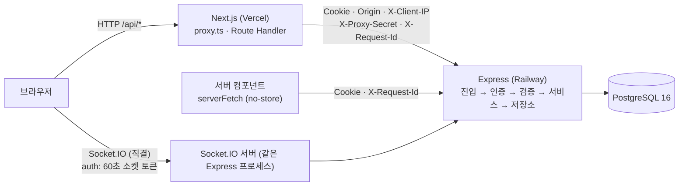
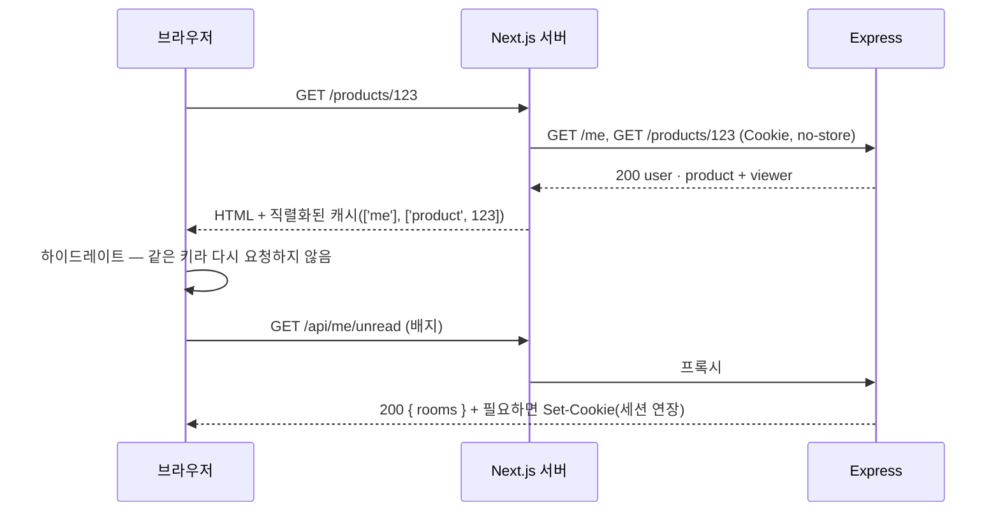
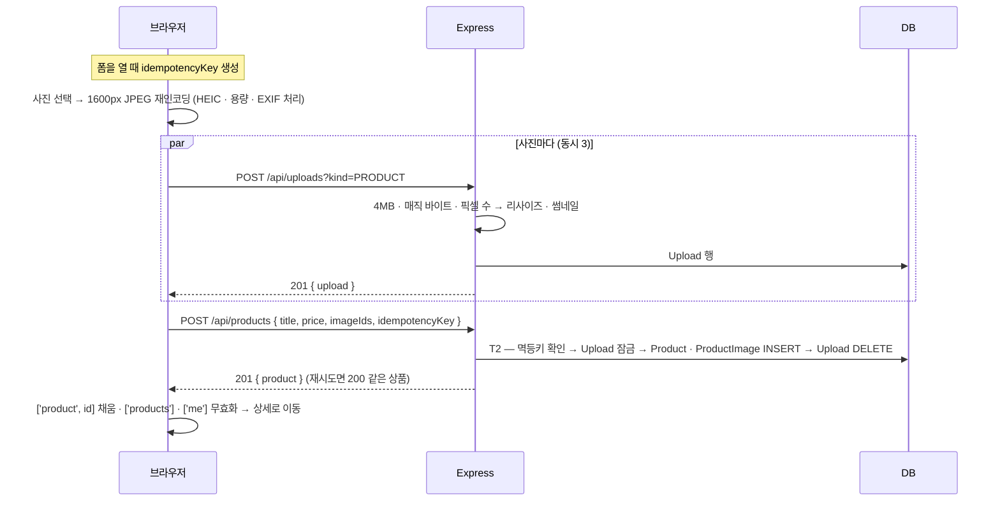
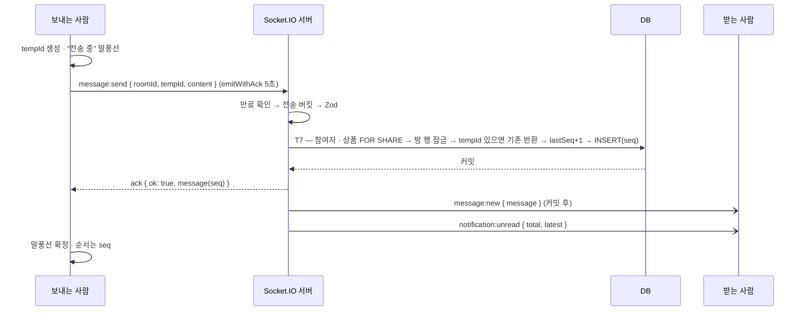
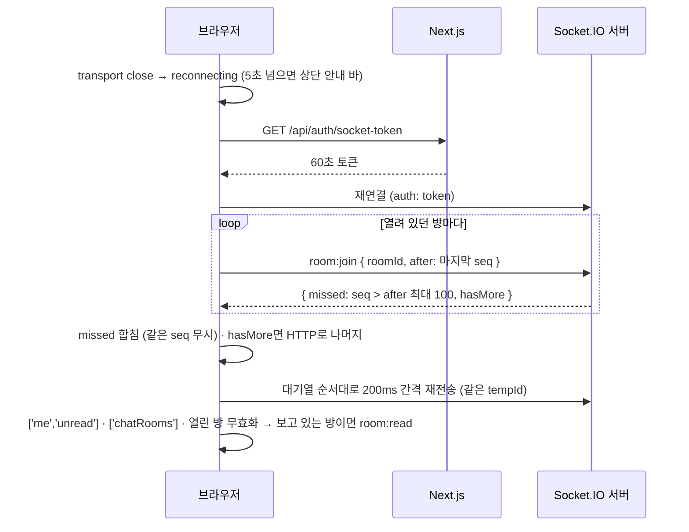

# 흐름 설계 — 프론트엔드와 백엔드가 한 동작을 나눠 처리하는 방식

[문서 목차](../README.md) · [흐름 설계](flow.md) · [프론트엔드 설계](frontend.md) · [백엔드 설계](backend.md) · 기능별 요구사항: [features/](../features/00-common.md)

**사용자 동작 하나가 브라우저 → Next.js 프록시 → Express → PostgreSQL을 지나 화면으로 돌아오는 길을 한 장에 정리했습니다.** 세부 규칙은 [프론트엔드 설계](frontend.md)와 [백엔드 설계](backend.md)에 있고, 이 문서는 두 설계가 만나는 지점 — 경로, 계약, 핵심 흐름 9개, 실패가 화면까지 오는 길 — 만 다룹니다.

## 1. 연결 경로

| 경로 | 쓰는 곳 | 이 경로에서 정한 것 | 근거 |
| --- | --- | --- | --- |
| 브라우저 → `/api/*` → Express | 모든 쓰기, 클라이언트 조회 | 같은 오리진이라 `SameSite=Lax` 쿠키가 그대로 간다. 프록시는 `Origin`을 복사하고, 원 IP를 공유 비밀과 함께 넘기고, `Set-Cookie`(세션 연장)를 그대로 돌려준다. 본문 한도는 Vercel의 4.5MB라 업로드는 4MB까지 | [결정 0004](../decisions.md#0004--프론트가-백엔드를-프록시해-같은-오리진을-유지한다) · [T-02](../troubleshooting.md#t-02) · [T-04](../troubleshooting.md#t-04) |
| 서버 컴포넌트 → Express | 첫 화면 렌더 | 사용자별 응답이 캐시에 남지 않게 `no-store`. 응답의 `Set-Cookie`는 버린다 — 렌더 중에는 쿠키를 쓸 수 없다 | [T-06](../troubleshooting.md#t-06) |
| 브라우저 → Socket.IO | 메시지 · 읽음 · 배지 · 상품 변경 알림 | Vercel 함수는 상시 연결을 중계하지 못해 직결. 쿠키 대신 `/api/auth/socket-token`으로 받은 60초 토큰을 연결 · 재연결마다 새로 싣는다. 허용 오리진 판단은 HTTP와 같은 함수 | [T-08](../troubleshooting.md#t-08) |
| `proxy.ts` | 보호 페이지 진입 | 세션 쿠키가 **있는지**만 본다(토큰 유효성은 서버 컴포넌트의 `/me`가 판단) | [프론트엔드 01](frontend.md#01--렌더링-전략) |

## 2. 두 역할이 만나는 계약

| 계약 | 프론트엔드 | 백엔드 | 어긋나지 않게 하는 장치 |
| --- | --- | --- | --- |
| 요청 · 응답 모양 | 화면 단위 타입으로 받는다 | 화면 단위 타입으로 직렬화한다 | 공유 Zod 스키마(`shared-schema/`), 백엔드 테스트가 응답도 `parse` |
| 입력 규칙 | 칸을 떠날 때 같은 함수로 정규화 · 검증해 미리 알린다 | 같은 함수로 다시 정규화 · 검증하고 최종 판단 | 정규화 함수와 스키마를 한 패키지에서 import |
| 실패 | 에러 코드마다 정해진 화면 반응 | 코드 하나에 HTTP 상태 · 문구를 카탈로그로 | [에러 코드 표](backend.md#06--에러-코드) ↔ [에러 경계](frontend.md#04--에러-경계) |
| 실시간 이벤트 | 이벤트마다 캐시 갱신 규칙 | 커밋 **후** 발행, 순서는 방별 `seq` | [소켓 이벤트](backend.md#9-소켓-이벤트) ↔ [소켓 이벤트 → 캐시](frontend.md#소켓-이벤트--캐시) |
| 재시도 안전성 | 같은 키로 다시 보낸다 (`idempotencyKey` · `tempId`) | 유니크 제약으로 한 번만 반영하고 기존 결과를 돌려준다 | [멱등성](backend.md#05--멱등성) |

원칙: **규칙은 백엔드가 강제하고, 프론트엔드는 사용자가 그 규칙에 부딪히기 전에 알려 줍니다.** 프론트엔드가 버튼을 숨겨도 백엔드는 같은 판단을 다시 합니다.

## 3. 핵심 흐름

### 3.1 첫 화면과 로그인 상태

- 로그인 여부를 서버에서 알고 그리므로 "로그아웃 화면 → 로그인 화면" 깜빡임이 없다 — [로그인](../features/02-login.md) AC-LI-03.
- 세션 연장은 마지막 `/api/me/unread`에서 일어난다. 로그인 상태의 모든 화면이 이 요청을 보내므로 연장이 빠지지 않는다 — AC-CM-03.

### 3.2 로그인

| 순서 | 프론트엔드 | 백엔드 |
| --- | --- | --- |
| 1 | 이메일 정규화(공백 · 대소문자 · 전각), 빈 칸 검사 | — |
| 2 | `POST /api/auth/login` | IP 한도(분당 10, 프록시가 넘긴 원 IP) → 정규화 → 사용자 조회(없으면 더미 해시와 비교해 응답 시간 동일) → bcrypt 비교 |
| 3 | — | 성공: JWT(`sub` · `ver`)를 `nb_session` 쿠키로, `200 { user }` / 실패: `401 INVALID_CREDENTIALS` (어느 쪽이 틀렸는지 말하지 않음) |
| 4 | 성공: `queryClient.clear()` → `next` 경로로 / 실패: 폼 상단 `role="alert"`, 비밀번호 칸 비움 | — |

### 3.3 상품 등록

- 사진은 선택 즉시 올라가고 등록 요청에는 식별자만 간다 — [결정 0010](../decisions.md#0010--사진은-선택-즉시-업로드하고-등록은-url만-보낸다).
- 등록 응답이 끊겨도 같은 `idempotencyKey`로 다시 보내면 상품은 하나 — [거래 등록](../features/04-product-create.md).
- 연결되지 않은 업로드는 24시간 뒤 배치가 지운다 — [보호 장치와 배치](backend.md#07--보호-장치와-배치).

### 3.4 채팅 시작

| 순서 | 프론트엔드 | 백엔드 |
| --- | --- | --- |
| 1 | 상세의 [채팅하기] — `viewer.existingChatRoomId`가 있으면 바로 그 방으로 | — |
| 2 | 없으면 버튼 잠그고 `POST /api/chat-rooms { productId }` | T6 — 상품 `FOR SHARE`(삭제 · 거래완료 · 본인 상품 확인) → ChatRoom · 참여자 두 행 INSERT |
| 3 | — | 같은 구매자가 동시에 두 번 눌러도 `(productId, buyerId)` 유니크 위반 → 기존 방 `200` |
| 4 | `['chatRoom', id]` 채움 · `['chatRooms']` 무효화 → `/chats/{id}` | — |

### 3.5 메시지 전송

| 실패 | 보내는 사람 화면 | 서버 |
| --- | --- | --- |
| 5초 안에 ack 없음 | "전송 실패 [재시도] [삭제]", 쓴 글 유지 | 이미 저장했다면 같은 `tempId` 재시도에 기존 메시지를 돌려준다 — 중복 없음 |
| 끊긴 상태에서 전송 | "연결 중…" 대기열 (30초 지나면 실패) | — |
| `RATE_LIMITED` | `retryAfterMs` 동안 [전송] 비활성, 대기 메시지는 그대로 | 토큰 버킷(용량 10, 초당 5) |
| `PRODUCT_DELETED` | 말풍선 실패 + 입력창 비활성 | 상품 `FOR SHARE`로 진행 중인 삭제 뒤의 값을 봄 |

### 3.6 끊김과 복구

받기를 먼저 끝내고 보내기를 합니다 — 그래야 대기열의 메시지가 놓친 메시지 **뒤에** 저장됩니다.

- 서버가 재시작돼도 출처는 DB라 빠지는 메시지가 없다. Socket.IO의 `connectionStateRecovery`는 재시작을 넘지 못해 쓰지 않는다 — [WebSocket 실험](../tech-notes.md#websocket과-socketio).
- 연결 중이라도 `message:new`의 `seq`가 마지막 + 1이 아니면 같은 방법으로 틈을 채운다 — [결정 0016](../decisions.md#0016--방-안-순서와-읽음-위치는-시각이-아니라-방별-번호seq로-센다).
- 서버가 토큰 만료로 끊으면(`io server disconnect`) 자동 재연결되지 않으므로 재로그인 화면으로 보낸다.

### 3.7 읽음과 배지

| 순서 | 프론트엔드 | 백엔드 |
| --- | --- | --- |
| 1 | 방이 보이는 상태에서 입장 · 수신 · 복귀할 때, **화면에 그린** 마지막 `seq`로 `room:read { roomId, seq }` (소켓이 없으면 `POST /api/chat-rooms/:id/read`) | — |
| 2 | 낙관적으로 배지 −1 | T8 — `lastReadSeq = GREATEST(기존, LEAST(seq, lastSeq))` — 뒤로 가지 않고, 없는 번호를 앞지르지 않음 |
| 3 | — | 방에 `room:read { lastReadSeq }`, 내 모든 세션에 `notification:unread { total }` |
| 4 | 상대 화면: 내 마지막 메시지 아래 "읽음" / 내 다른 탭: 배지 동기화 | — |

배지 숫자는 읽지 않은 **방** 수이며 `ChatRoom.lastSeq > ChatRoomMember.lastReadSeq`로 Message 테이블 없이 계산한다 — [채팅 알림](../features/10-notification.md).

### 3.8 거래완료와 구매자 지정

| 순서 | 프론트엔드 | 백엔드 |
| --- | --- | --- |
| 1 | 판매자가 상태 `<select>`에서 거래완료 → 바텀시트에 채팅 상대 목록(`GET /products/:id/chat-partners`) | — |
| 2 | `PATCH /api/products/:id/status { status: SOLD, buyerId }` | T4 — 구매자가 이 상품의 채팅 상대인지 확인 → `UPDATE ... WHERE status IN (허용된 이전 상태)`, `soldPrice` 스냅샷 |
| 3 | — | 0행이면 다시 읽어 원인 구분: 없음 `404` · 남의 것 `403` · 전이 불가 `409 INVALID_TRANSITION` |
| 4 | 성공: `['product']` 갱신 · 목록 · 마이 개수 무효화 / `409`: `<select>` 되돌리고 상품 재조회 | 커밋 후 그 상품의 모든 방에 `room:product_updated` |
| 5 | 채팅 중인 상대 화면: 상품 요약 바의 상태가 바뀜 | 구매자 마이페이지 구매 내역에 표시 |

### 3.9 삭제 전파

`DELETE /api/products/:id` → T5(`deletedAt` 기록, 조건부 UPDATE) → 커밋 후 `room:product_updated { deletedAt }`. 삭제 하나가 다섯 화면에 닿습니다.

| 화면 | 보이는 것 | 누가 맞추나 |
| --- | --- | --- |
| 목록 · 검색 | 사라짐 | 판매자: 캐시에서 제거 / 다른 사람: 다음 조회 |
| 상세 | `404` 화면 | 서버 응답 |
| 채팅 목록 | "삭제됨" 라벨로 남음 | 소켓 이벤트 · 재조회 |
| 채팅방 | 기록은 열람, 입력창 비활성 | `room:product_updated` |
| 구매 내역 | 거래완료였다면 "삭제됨" 라벨로 남음 | 다음 조회 |

## 4. 실패가 화면까지 오는 길

| 실패 지점 | 서버 응답 | 프론트엔드 반응 |
| --- | --- | --- |
| 프록시 이전 (네트워크 끊김 · 시간 초과) | — | 조회: 영역에 "불러오지 못했어요 [다시 시도]" / 쓰기: 토스트 + 입력 유지, 자동 재시도 없음 |
| 진입 (본문 · Origin · 요청 수) | `413` · `403 ORIGIN_MISMATCH` · `429` + `Retry-After` | 썸네일 오류 · 일반 토스트 · 그 시간 동안 버튼 비활성 |
| 인증 | `401 UNAUTHORIZED` | `next`를 붙여 로그인 화면으로 |
| 검증 | `400 VALIDATION_FAILED` + `fields` | 필드별 오류를 `aria-describedby`로 연결, 첫 오류 칸으로 포커스 |
| 권한 · 존재 | `403` · `404` | 토스트 후 이전 화면 / 404 화면 |
| 상태 충돌 | `409` (전이 불가 · 이미 판매됨 · 중복 닉네임) | 해당 칸 오류 또는 되돌리고 재조회 |
| 예상 못 한 오류 | `500 INTERNAL` + `X-Request-Id` | 일반 오류 화면에 요청 ID 표시 → 같은 ID로 서버 로그 검색 |

전체 코드 표는 [에러 코드](backend.md#06--에러-코드), 화면 쪽 처리 범위는 [에러 경계](frontend.md#04--에러-경계)에 있습니다.

## 5. 흐름을 바꿀 때 함께 볼 곳

| 바꾸려는 것 | 백엔드 | 프론트엔드 | 기능 문서 |
| --- | --- | --- | --- |
| 메시지 순서 · 복구 · 읽음 | [트랜잭션 T7 · T8](backend.md#03--트랜잭션-경계) · [소켓 서버](backend.md#09--소켓-서버) | [소켓 클라이언트](frontend.md#07--소켓-클라이언트) · [캐시](frontend.md#03--캐시와-낙관적-갱신) | [채팅](../features/08-chat.md) · [채팅 알림](../features/10-notification.md) |
| 상품 상태 규칙 | [트랜잭션 T4](backend.md#03--트랜잭션-경계) · [권한](backend.md#04--권한-매트릭스) | [캐시 갱신 범위](frontend.md#03--캐시와-낙관적-갱신) | [거래 상세](../features/05-product-detail.md) |
| 업로드 형식 · 크기 | [보호 장치](backend.md#07--보호-장치와-배치) | [폼](frontend.md#05--폼) | [거래 등록](../features/04-product-create.md) |
| 인증 · 세션 | [요청 계층](backend.md#01--요청-계층) | [렌더링](frontend.md#01--렌더링-전략) | [로그인](../features/02-login.md) |
| 배포 경로 (도메인 · 프록시) | [보호 장치 — 프록시 뒤 IP](backend.md#07--보호-장치와-배치) | [렌더링](frontend.md#01--렌더링-전략) | [결정 0004](../decisions.md#0004--프론트가-백엔드를-프록시해-같은-오리진을-유지한다) |

변경 전에 [개요 2.4 변경 영향 매트릭스](../overview.md#24-변경-영향-매트릭스)에서 닿는 데이터 · 화면 · API를 먼저 확인합니다.
