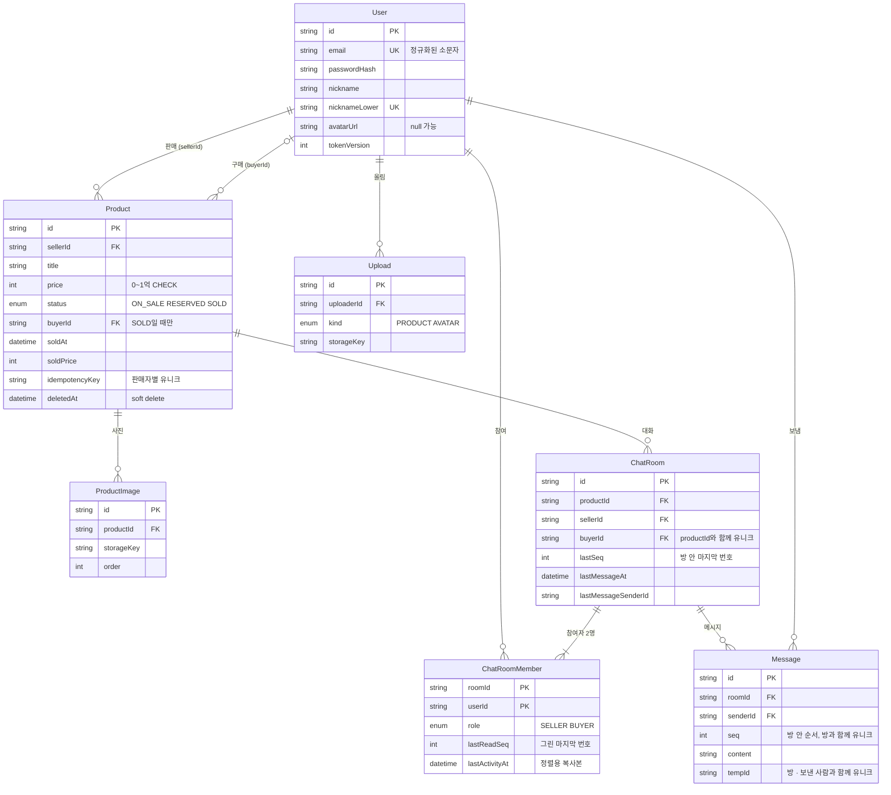

# 백엔드 02 · 데이터 모델

[백엔드 설계](README.md) · 앞: [01 요청 계층](01-layers.md) · 다음: [03 트랜잭션 경계](03-transactions.md)

**테이블 일곱 개로 열 가지 기능을 덮고, 규칙 중 "절대 깨지면 안 되는 것"은 애플리케이션이 아니라 DB 제약으로 둡니다.** 애플리케이션 검증은 사용자에게 친절한 문구를 주기 위한 것이고, 동시 요청 · 버그 · 수동 수정에도 버티는 마지막 선은 유니크 인덱스와 CHECK 제약입니다. 00 개요 [2.2 엔티티 표](../00-overview.md#22-핵심-엔티티와-핵심-필드)를 스키마로 옮긴 것이며, 01 요구사항 [12절](../01-requirements.md#12-02-데이터-모델로-넘기는-것)에서 넘긴 여섯 가지를 여기서 정합니다.

## 1. 01에서 넘긴 여섯 가지 결정

| # | 질문 | 결정 | 왜 |
| --- | --- | --- | --- |
| 1 | 읽음 위치를 `ChatRoomMember` 테이블에 둘까, `ChatRoom`의 두 컬럼(`sellerLastReadAt` · `buyerLastReadAt`)에 둘까 | **`ChatRoomMember` 테이블** + 정렬용 `lastActivityAt` 비정규화 | 채팅 목록은 "내가 참여한 방을 최근 활동순으로"인데, 두 컬럼 안은 `WHERE sellerId = me OR buyerId = me ORDER BY ...`가 되어 인덱스 하나로 정렬 · 커서를 처리할 수 없다(OR는 두 인덱스 결과를 합쳐야 함). 참여자 행에 `lastActivityAt`을 복사해 두면 `(userId, lastActivityAt DESC, roomId)` 인덱스 하나로 목록 · 커서 · 배지가 끝난다. 대가: 메시지마다 참여자 두 행을 갱신 |
| 2 | 임시 업로드를 `Upload` 테이블로 둘까, `ProductImage.productId`를 nullable로 둘까 | **별도 `Upload` 테이블**, 연결 시 `ProductImage`를 만들고 `Upload` 행은 같은 트랜잭션에서 삭제 | 아바타도 같은 업로드 경로를 쓰므로 `ProductImage`에 섞으면 상품 아닌 행이 생긴다. 정리 배치는 `Upload`만 보면 되고, `ProductImage`는 "상품에 붙은 사진"이라는 뜻을 잃지 않는다 |
| 3 | 거래완료 후 판매자가 가격을 고치면 구매 내역 가격도 바뀌어야 하나 | **`soldPrice` 스냅샷** — 거래완료 전이 때 저장, 판매중 복귀 시 `null` | 구매 기록은 거래 시점의 사실. 판매자 수정이 구매자 화면을 바꾸면 안 된다 [결정 0013] |
| 4 | ID 형식 | **전 테이블 `cuid()`** (Prisma 기본 생성) | 상품 · 방 목록 정렬은 `(정렬 시각, id)` 복합 커서, 메시지는 방별 번호 `seq`([결정 0016](../decisions/0016-message-seq.md))로 하므로 ID 자체가 시간순일 필요가 없다. 형식이 하나면 검증 · 로그가 단순. 추측 불가 조건은 만족 [AC-CM-35] |
| 5 | 이메일 · 닉네임 유니크를 부분 인덱스(`WHERE deletedAt IS NULL`)로 둘까 | **1차는 일반 유니크.** 탈퇴(2차)가 생길 때 부분 인덱스로 바꾸는 마이그레이션 | 탈퇴가 없으니 `deletedAt`은 항상 `null` — 두 인덱스는 지금 같은 동작. Prisma 스키마가 부분 인덱스를 표현하지 못해 원시 SQL이 필요한데, 쓰지 않는 기능을 위해 미리 넣지 않는다 |
| 6 | 인덱스 | 아래 4절 — 쿼리마다 어떤 인덱스를 타는지 표로 | — |

## 2. ERD



`Notification` · `Category` · `Favorite` · `Trade` 테이블은 없다. 각각 없는 이유는 [00 개요 2.2](../00-overview.md#22-핵심-엔티티와-핵심-필드)와 결정 [0008](../decisions/0008-badge-means-rooms.md) · [0012](../decisions/0012-buyer-assignment.md).

## 3. Prisma 스키마

**Prisma 7.x 정식판 기준**(2026-11 확인 7.10.1). 7부터 연결 주소는 스키마가 아니라 `prisma.config.ts`에 두고, 클라이언트는 드라이버 어댑터(`@prisma/adapter-pg`)로 연결한다. 아래 스키마는 Prisma 스키마 검증기(`@prisma/prisma-schema-wasm`)로 **검증 통과**를 확인했다. npm `latest` 태그는 8.0 RC이므로 정식판이 나오기 전엔 7.x로 고정한다.

```prisma
generator client {
  provider = "prisma-client"
  output   = "../src/generated/prisma"
}

datasource db {
  provider = "postgresql" // 연결 주소는 prisma.config.ts
}

enum ProductStatus {
  ON_SALE
  RESERVED
  SOLD
}

enum UploadKind {
  PRODUCT
  AVATAR
}

enum MemberRole {
  SELLER
  BUYER
}

model User {
  id            String    @id @default(cuid())
  email         String    @unique // normalizeEmail() 결과만 저장
  passwordHash  String
  nickname      String // 표시용 — 입력한 대소문자 그대로
  nicknameLower String    @unique // 중복 판단용
  avatarUrl     String?
  tokenVersion  Int       @default(0) // 비밀번호 변경 시 +1 → 기존 토큰 무효
  lastLoginAt   DateTime?
  createdAt     DateTime  @default(now())
  updatedAt     DateTime  @updatedAt
  deletedAt     DateTime? // 탈퇴(2차) 대비. 1차에는 항상 null

  products    Product[]        @relation("ProductSeller")
  purchases   Product[]        @relation("ProductBuyer")
  uploads     Upload[]
  roomsSold   ChatRoom[]       @relation("RoomSeller")
  roomsBought ChatRoom[]       @relation("RoomBuyer")
  memberships ChatRoomMember[]
  messages    Message[]
}

model Product {
  id             String        @id @default(cuid())
  sellerId       String
  title          String
  price          Int // 원 단위 정수. 0 = 나눔
  description    String        @default("")
  status         ProductStatus @default(ON_SALE)
  buyerId        String? // SOLD일 때만 값 (CHECK)
  soldAt         DateTime? // SOLD일 때만 값 (CHECK)
  soldPrice      Int? // 거래완료 시점 가격 스냅샷
  idempotencyKey String // 클라이언트가 폼을 열 때 만든 uuid
  createdAt      DateTime      @default(now())
  updatedAt      DateTime      @updatedAt
  deletedAt      DateTime?
  imagesPurgedAt DateTime? // 삭제 30일 후 파일 정리 완료 시각

  seller    User           @relation("ProductSeller", fields: [sellerId], references: [id])
  buyer     User?          @relation("ProductBuyer", fields: [buyerId], references: [id])
  images    ProductImage[]
  chatRooms ChatRoom[]

  @@unique([sellerId, idempotencyKey])
  @@index([deletedAt, createdAt(sort: Desc), id(sort: Desc)]) // 홈 목록 · 커서
  @@index([sellerId, status, createdAt(sort: Desc)]) // 마이페이지 판매 탭
  @@index([buyerId, soldAt(sort: Desc)]) // 구매 내역
}

model ProductImage {
  id           String   @id @default(cuid())
  productId    String
  storageKey   String // ImageStorage가 쓰는 키 — URL은 키에서 만든다
  url          String
  thumbnailUrl String
  width        Int
  height       Int
  order        Int // 0 = 대표
  createdAt    DateTime @default(now())

  product Product @relation(fields: [productId], references: [id], onDelete: Cascade)

  @@index([productId, order])
}

model Upload {
  id           String     @id @default(cuid())
  uploaderId   String
  kind         UploadKind
  storageKey   String
  url          String
  thumbnailUrl String?
  width        Int
  height       Int
  createdAt    DateTime   @default(now())

  uploader User @relation(fields: [uploaderId], references: [id])

  @@index([createdAt]) // 24시간 지난 고아 정리 배치
}

model ChatRoom {
  id                  String    @id @default(cuid())
  productId           String
  sellerId            String
  buyerId             String
  lastSeq             Int       @default(0) // 방 안 마지막 메시지 번호 — 저장 시 +1 하며 방 행을 잠근다 (결정 0016)
  lastMessageAt       DateTime? // 메시지가 없으면 null
  lastMessagePreview  String?
  lastMessageSenderId String?
  createdAt           DateTime  @default(now())

  product  Product          @relation(fields: [productId], references: [id])
  seller   User             @relation("RoomSeller", fields: [sellerId], references: [id])
  buyer    User             @relation("RoomBuyer", fields: [buyerId], references: [id])
  members  ChatRoomMember[]
  messages Message[]

  @@unique([productId, buyerId]) // 상품 × 구매자당 방 하나
  @@index([productId]) // 거래완료 바텀시트의 채팅 상대 목록 · 상품 변경 브로드캐스트
}

model ChatRoomMember {
  roomId         String
  userId         String
  role           MemberRole
  lastReadSeq    Int        @default(0) // 화면에 그린 마지막 메시지 번호 (결정 0016)
  lastActivityAt DateTime   @default(now()) // ChatRoom 활동 시각의 복사본 — 목록 정렬을 이 테이블 인덱스 하나로
  joinedAt       DateTime   @default(now())

  room ChatRoom @relation(fields: [roomId], references: [id])
  user User     @relation(fields: [userId], references: [id])

  @@id([roomId, userId])
  @@index([userId, lastActivityAt(sort: Desc), roomId(sort: Desc)]) // 채팅 목록 · 커서 · 배지
}

model Message {
  id        String   @id @default(cuid())
  roomId    String
  senderId  String
  seq       Int // 방 안 순서 — 커서 · 복구 · 읽음의 기준 (결정 0016)
  content   String
  tempId    String // 클라이언트가 만든 전송 식별자 — 재시도 중복 방지
  createdAt DateTime @default(now()) // 표시 전용. 트랜잭션 시작 시각이라 순서에 쓰지 않는다

  room   ChatRoom @relation(fields: [roomId], references: [id])
  sender User     @relation(fields: [senderId], references: [id])

  @@unique([roomId, seq]) // 과거 방향(before) · 이후 방향(after) 둘 다 이 인덱스로
  @@unique([roomId, senderId, tempId])
}
```

### DB가 마지막으로 지키는 것 — CHECK 제약

Prisma 스키마로 표현할 수 없어 첫 마이그레이션 SQL에 직접 추가한다. 애플리케이션 검증을 통과한 버그 · 수동 수정 · 경합에도 깨지면 안 되는 것만 고른다.

```sql
-- 가격은 0 이상 1억 이하
ALTER TABLE "Product" ADD CONSTRAINT product_price_range CHECK (price BETWEEN 0 AND 100000000);
-- 거래완료일 때만 soldAt이 있다 (둘은 함께 움직인다)
ALTER TABLE "Product" ADD CONSTRAINT product_sold_at CHECK ((status = 'SOLD') = ("soldAt" IS NOT NULL));
-- 구매자 · 거래 가격은 거래완료일 때만
ALTER TABLE "Product" ADD CONSTRAINT product_buyer_only_sold CHECK (status = 'SOLD' OR ("buyerId" IS NULL AND "soldPrice" IS NULL));
-- 자기 물건의 구매자가 될 수 없다
ALTER TABLE "Product" ADD CONSTRAINT product_buyer_not_seller CHECK ("buyerId" IS NULL OR "buyerId" <> "sellerId");
-- 자기 물건에 채팅방을 만들 수 없다
ALTER TABLE "ChatRoom" ADD CONSTRAINT room_buyer_not_seller CHECK ("buyerId" <> "sellerId");
-- 빈 메시지 · 비정상적으로 긴 메시지. 정확한 1,000자(grapheme) 제한은 공유 스키마가 하고,
-- DB는 "어떤 1,000자도 통과하는" 상한만 둔다 — 가족 이모지 하나가 코드포인트 7~11개라 4,000은 정상 메시지를 막는다
ALTER TABLE "Message" ADD CONSTRAINT message_length CHECK (char_length(content) BETWEEN 1 AND 16000);
```

**왜 상태 전이(판매중 → 예약중 …)는 CHECK로 두지 않나**: CHECK는 한 행의 "현재 값"만 볼 수 있고 "이전 값"을 모른다. 전이 규칙은 트리거로만 강제할 수 있는데, 트리거는 규칙을 코드 밖으로 숨긴다 [결정 0001]. 대신 조건부 UPDATE(`WHERE status IN (허용된 이전 상태)`)로 서비스가 강제한다 ([03 트랜잭션](03-transactions.md)).

## 4. 인덱스 — 쿼리마다 무엇을 타는가

| 쿼리 | 조건 · 정렬 | 인덱스 | 근거 AC |
| --- | --- | --- | --- |
| 홈 목록 | `deletedAt IS NULL ORDER BY createdAt DESC, id DESC` + 커서 | `Product(deletedAt, createdAt DESC, id DESC)` | AC-PL-01, 03 |
| 홈 목록 + 거래완료 숨김 | 위 + `status <> 'SOLD'` | 같은 인덱스 + 필터 (거래완료 비율이 낮아 충분) | AC-PL-13 |
| 제목 검색 | `title ILIKE '%q%'` | **1차는 순차 스캔 허용.** 상품 수만 건 이상이면 `pg_trgm` GIN 인덱스 | AC-PL-12 |
| 마이페이지 판매 탭 | `sellerId = me AND status = ? AND deletedAt IS NULL` | `Product(sellerId, status, createdAt DESC)` | AC-MP-02 |
| 구매 내역 | `buyerId = me AND status = 'SOLD'` (삭제 포함) | `Product(buyerId, soldAt DESC)` | AC-MP-04 |
| 판매자별 멱등키 확인 | `sellerId = ? AND idempotencyKey = ?` | 유니크 `Product(sellerId, idempotencyKey)` | AC-PC-08 |
| 채팅방 찾기 · 만들기 | `productId = ? AND buyerId = ?` | 유니크 `ChatRoom(productId, buyerId)` | AC-PD-13, 15 |
| 상품의 채팅 상대 · 채팅 수 | `productId = ?` | `ChatRoom(productId)` | AC-PD-04, AC-PL-01 |
| 채팅 목록 | `userId = me ORDER BY lastActivityAt DESC, roomId DESC` + 커서 | `ChatRoomMember(userId, lastActivityAt DESC, roomId DESC)` | AC-CL-01 |
| 배지 (읽지 않은 방 수) | 내 참여자 행 ⨝ 방, `r.lastSeq > m.lastReadSeq` | `ChatRoomMember(userId, ...)` 앞부분 + 방 기본키 | AC-NT-02 |
| 메시지 최신 50 · 과거 | `roomId = ? AND seq < 커서 ORDER BY seq DESC` | 유니크 `Message(roomId, seq)` 역방향 스캔 | AC-CH-10, 11 |
| 재연결 누락분 · 틈 채우기 | `roomId = ? AND seq > after ORDER BY seq LIMIT 101` | 같은 인덱스 정방향 | AC-CH-05 |
| 전송 재시도 중복 | `roomId · senderId · tempId` | 유니크 `Message(roomId, senderId, tempId)` | AC-CH-04 |
| 방별 읽지 않은 수 | `roomId = ? AND seq > lastReadSeq AND senderId <> me` | `Message(roomId, seq)` 범위 | AC-CL-04 |
| 고아 업로드 정리 | `createdAt < now() - 24h` | `Upload(createdAt)` | AC-PC-19 |

**확인 방법**: 구현 단계에서 각 쿼리를 시드 데이터(상품 1만 · 방 1천 · 메시지 10만)에 대해 `EXPLAIN ANALYZE`로 돌리고 결과를 [기술 노트 `postgres-constraints.md`](../tech/README.md)에 남긴다.

## 5. 필드 규칙 요약

| 필드 | 저장 형태 | 검증 위치 | 근거 |
| --- | --- | --- | --- |
| `User.email` | `normalizeEmail()` 결과 (소문자 · NFKC · 공백 · 제로폭 제거) | 공유 스키마 + 유니크 | AC-SU-06 |
| `User.passwordHash` | `normalizePassword()` 후 bcrypt cost 12 | 공유 스키마 | AC-SU-09b, 23 |
| `User.nickname` / `nicknameLower` | 입력 그대로 / 소문자 | 공유 스키마 + 유니크(`nicknameLower`) | AC-SU-14 |
| `Product.price` | 정수 원 | 공유 스키마 + CHECK | AC-PC-06 |
| `Product.title` · `description` | `normalizeText()` 결과 | 공유 스키마 (grapheme 길이) | AC-PC-05, 07 |
| `Message.content` | `normalizeText()` 결과, 연속 줄바꿈 축소 | 공유 스키마 + CHECK(코드포인트 상한) | AC-CH-13, AC-CM-54 |
| 모든 시각 | `timestamptz` (UTC) | — | AC-CM-50 |

grapheme 길이는 DB가 셀 수 없으므로(Postgres `char_length`는 코드포인트) DB CHECK는 넉넉한 상한만 두고, 정확한 제한은 공유 스키마가 한다.

## 6. 바뀔 가능성

| 바뀌면 | 영향 |
| --- | --- |
| 그룹 채팅 | `ChatRoomMember`가 이미 있어 참여자 수만 늘리면 됨. 단 `ChatRoom(productId, buyerId)` 유니크와 `MemberRole`은 다시 설계 |
| 탈퇴 | 이메일 · 닉네임 유니크를 부분 인덱스로 (결정 5), 탈퇴 사용자 표시 규칙 |
| 후기 · 매너온도 | `Trade` 테이블로 `buyerId · soldAt · soldPrice` 승격 [결정 0012] |
| 상품 10만 건 이상 | 검색에 `pg_trgm`, 목록 인덱스를 `WHERE deletedAt IS NULL` 부분 인덱스로 |
